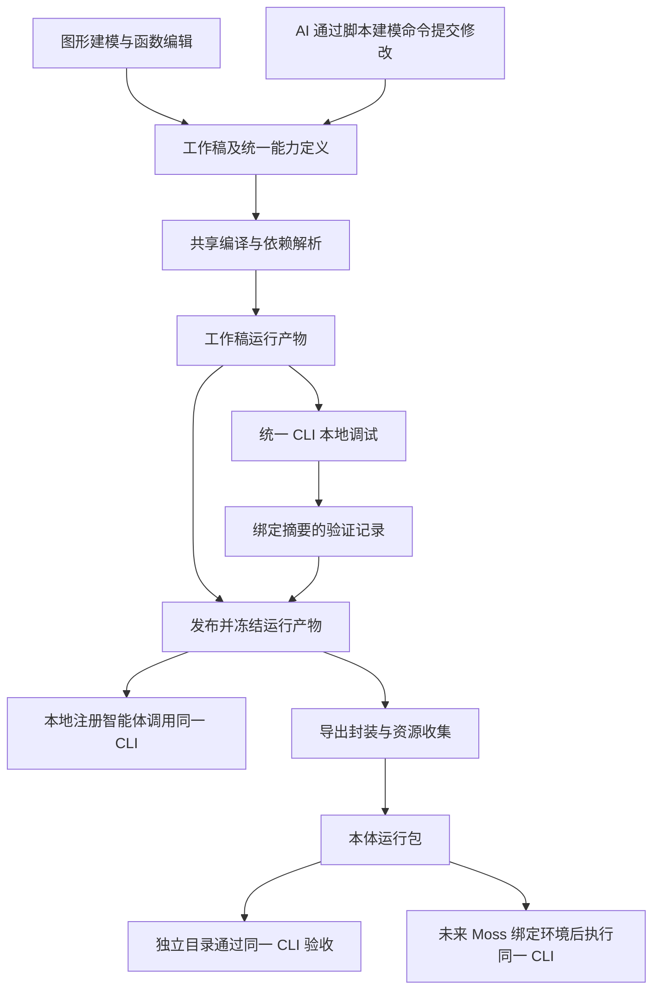

# 本体脚本运行与可移植运行包实施方案

状态：方案已确认，按统一脚本链路实施。具体命令和当前实现边界见 [本体脚本运行与导出](../tech/ontology-script-runtime.md)。

范围调整：用户明确不要求历史本体数据兼容，本轮不实施旧 MCP 产物迁移；原文中的历史迁移设想不作为交付要求。

2026-10-27 补充：完整交付格式统一规划为 `.sudoonto`，同时支持“客户端下载、修改、重新导出上架”和“未来 Moss 发布企业智能体供普通用户使用”两条链路。客户端需要完成可编辑导入闭环，当前包协议必须支持未来企业部署；Moss 功能仍后续实施。具体产品要求与本轮验收以[双向流转与企业智能体交付补充方案](./2026-10-27-sudoonto-circulation-and-enterprise-runtime.md)为准。

日期：2026-10-26

适用范围：Sudowork 本地本体建模、调试、发布及导出；为后续 Moss 本体库导入和智能体发布确定交付契约。

## 1. 方案结论

采用“本体定义 + 能力脚本 + 智能体定义 + 资源绑定声明”的交付方式，提供统一 CLI，复用 Agent 已有的命令执行能力。

不新增原生本体工具适配器，不要求为每个本体或智能体启动 MCP Server，不重新引入本体 Skill 发布层。

**本地建模生成的就是最终运行的能力脚本。本地调试直接执行这些脚本；发布冻结验证过的运行产物；导出封装该产物。禁止本地使用一套 MCP 专属执行逻辑、导出时再生成另一套脚本实现。**

本地与未来 Moss 只允许环境绑定、凭据来源、宿主权限和工作目录不同。本体定义、能力标识、参数契约、实现代码、执行语义及结果协议保持一致。

本轮完成 Sudowork 侧的统一执行链路、完整导出、包加载和独立运行验收。Moss 的本体库页面、上传审批、部署编排、租户发布和计费接入另行实施。

## 2. 已确认的产品要求

1. 本体是独立资源，不需要先发布为 Skill。
2. 本体包必须包含 RDF/OWL 等语义定义、业务能力及其完整实现。
3. 本地数据库地址和凭据不应写死在能力中；目标环境可以手工填写连接配置。
4. 本体包附带默认智能体定义，后续可以从本体库选择本体并发布智能体。
5. 普通用户使用已发布智能体时，能力在服务端执行，不依赖作者的电脑。
6. 多人可以共用本体定义和能力；用户会话、记忆、临时文件和数据访问授权保持隔离。
7. 首期以轻量脚本调用为主，不为每个智能体配套独立服务进程。
8. 本地调试与交付后的运行必须使用同一套规范和执行代码。

## 3. 当前实现与缺口

| 当前实现                                            | 缺口                                           | 本轮处理                                                    |
| --------------------------------------------------- | ---------------------------------------------- | ----------------------------------------------------------- |
| exportStandardFile 导出 RDF/XML 或 OWL/XML          | 不包含完整能力实现和环境依赖                   | 保留标准导出，新增运行包导出                                |
| 版本快照包含模型、映射、规则、函数和动作            | 连接器与数据资产位于工作台环境，版本依赖不闭合 | 增加非敏感运行依赖记录与资源解析                            |
| 本体 MCP 描述文件省略函数 body 和动作 configuration | 该文件不能独立运行                             | 不将 MCP 描述文件当作运行包                                 |
| MCP 收到调用后通过 HTTP 回调 OntologyService        | 业务执行依赖原桌面进程                         | 抽出共享执行库，由统一 CLI 调用                             |
| 智能体注册生成本地规则和 MCP 配置                   | 注册实例信息不适合跨机器迁移                   | 导出智能体定义，目标平台重新创建运行实例                    |
| 本地自定义脚本引用绝对命令路径                      | 换机器后不可执行                               | 改为受支持的解释器与包内脚本引用，或明确报告不兼容          |
| Moss 组织目录支持 agent、skill                      | 尚无 ontology 资源和部署绑定模型               | 本轮只定义对接契约，不修改 Moss                             |
| Sudowork 已区分 RDF 与 Sudograph 项目               | 两种模型权威不能相互覆盖                       | 包记录模型权威；首期 RDF 完整落地，其他类型显式报告支持状态 |

相关代码入口见第 19 节。以上判断基于本地源码检查，不将未来规划写成既有能力。

## 4. 统一链路：建模、调试、发布、导出使用同一产物

### 4.1 唯一执行基准



以下规则是实现约束：

- 保存能力实现时就生成或更新对应的工作稿脚本产物，调试前检查产物与工作稿修订是否一致。
- 本地“运行函数”“测试关系”“执行动作”调用统一 CLI，不再使用仅存在于桌面服务内的另一套执行器。
- 发布引用已经构建的产物，记录其内容摘要；不能发布与界面当前修订不一致的旧产物。
- 本地注册的运行时智能体使用发布产物，不读取持续变化的工作稿。
- 导出不得改变 SQL、重写业务算法或生成不同的函数包装语义。资源快照和环境引用转换只通过统一的资源封装规则完成。
- 未来 Moss 不再编译一套业务实现；它加载同一产物，检查兼容性并提供资源绑定。
- 所有入口共用能力目录、参数校验、结果协议、错误码和执行实现。

### 4.2 建模通信与能力执行的区别

“同一套规范”不要求图形界面放弃 IPC，也不要求把本地工作台数据库复制到 Moss。

- 图形界面仍通过 IPC 保存模型、处理修订冲突和更新界面。
- AI 建模通过统一脚本命令读取模型契约、提交结构化修改和触发检查。
- 本地数据库中的工作稿继续作为已有项目的权威来源；生成的工作稿运行目录是受管理的产物，不能再作为第二份可独立编辑的权威模型。
- AI 脚本提交修改时，通过宿主提供的受限建模接口复用现有事务、修订检查与项目归属校验；不直接绕过宿主读取加密数据库。
- 该建模接口仅用于工作稿编辑。运行包的查询、关系遍历、函数和动作不得回调它。

建议命令分为两组，使用同一个 CLI 协议：

| 命令组   | 示例                                                   | 运行场景                                    |
| -------- | ------------------------------------------------------ | ------------------------------------------- |
| 建模命令 | project contract / read / apply / check / build        | 本地工作台；需要宿主授予的建模上下文        |
| 运行命令 | inspect / list / describe / validate / invoke / verify | 本地工作稿、已发布产物、独立目录和未来 Moss |

导出的已发布包只开放运行命令，不能通过它修改本体库中的发布版本。AI 建模命令不再要求 MCP；运行命令不需要任何桌面建模服务。

### 4.3 兼容迁移

现有项目先保留原始工作稿及发布版本，不进行破坏性重写。首次构建时将旧函数和动作转换成统一能力定义，并保留原始 ID、code、输入输出与业务行为。

可以保留旧 MCP 接口作为兼容入口，但它只能调用同一个执行库或 CLI。验收时关闭 MCP，主要流程必须仍然可用。

旧项目一旦进入新脚本执行路径，不得在失败时自动回退到旧 MCP 执行路径，否则会掩盖产物缺失或环境不兼容。

## 5. 交付物及身份划分

### 5.1 三种身份分别管理

| 对象           | 内容                                            | 是否导出           |
| -------------- | ----------------------------------------------- | ------------------ |
| 本体发布定义   | 语义模型、运行映射、能力及资源要求              | 是                 |
| 默认智能体定义 | 名称建议、说明、指令、能力引用、模型能力要求    | 是                 |
| 部署及运行实例 | 租户、实例 ID、地址、凭据、会话、记忆、资源配额 | 否，由目标平台创建 |

本体可以在没有注册本地智能体的情况下导出。此时生成默认智能体定义；已有本地智能体时，可选择保留其自定义指令。

本地注册状态、registeredAssistantId、历史注册记录、MCP 端口、临时 Token、执行 PID 和会话历史不进入包。

### 5.2 包形态

默认产物使用 .ontology.zip，内部为统一目录结构。导出目录与 ZIP 使用相同规范；首版产品可以只提供 ZIP，目录形态用于调试和验收。

```text
northwind.ontology.zip
├── manifest.json
├── ontology/
│   ├── model.rdf
│   ├── runtime-model.json
│   └── mappings.json
├── capabilities/
│   ├── catalog.json
│   └── implementations/
│       ├── sales-report.sql
│       ├── calculate-margin.js
│       └── forecast.py
├── scripts/
│   └── ontology.cjs
├── agent/
│   ├── definition.json
│   └── AGENT.md
├── environment/
│   ├── resources.json
│   ├── bindings.schema.json
│   ├── bindings.example.json
│   └── runtime.lock.json
├── assets/
│   └── business.db
├── verification/
│   ├── smoke-tests.json
│   └── export-report.json
└── checksums.json
```

assets 中仅包含明确选入的资源。只有外部实时资源的包可以没有该目录。

### 5.3 文件职责

| 文件                       | 内容要求                                                        |
| -------------------------- | --------------------------------------------------------------- |
| manifest.json              | 包身份、格式版本、来源发布版本、模型权威、入口和兼容要求        |
| model.rdf                  | 标准语义表达，保留 IRI、类型、属性、关系、公理等信息            |
| runtime-model.json         | 该发布版本的执行投影及平台扩展；不包含工作台状态                |
| mappings.json              | 对象、属性与逻辑数据资源之间的映射                              |
| catalog.json               | 所有可调用能力的稳定 ID、输入输出结构、实现引用、依赖及读写属性 |
| implementations            | 完整 SQL、JS、Python 或其他已声明的能力资源                     |
| ontology.cjs               | 由项目构建产出的统一 CLI 入口                                   |
| definition.json / AGENT.md | 智能体定义与使用说明，不承载真正的权限判断                      |
| resources.json             | 资源类型、结构要求、包内位置或外部绑定槽位                      |
| bindings.schema.json       | 目标环境需要填写的配置结构                                      |
| bindings.example.json      | 不含真实凭据的配置示例                                          |
| runtime.lock.json          | CLI、执行库、驱动和解释器的兼容及版本记录                       |
| verification               | 验证用例、验证级别、资源快照时间及阻塞项                        |
| checksums.json             | 包内文件摘要、文件大小和完整性信息                              |

RDF 与执行投影由同一个固定版本生成。执行投影必须绑定来源摘要，加载器校验二者对应关系；不允许将其中一份修改后继续使用另一份旧内容。

### 5.4 Manifest 示例

以下为拟定协议，字段在第一阶段冻结后再进入实现：

```json
{
  "kind": "ontology-runtime-package",
  "formatVersion": 1,
  "ontologyId": "urn:uuid:865f93a7-44ca-435d-968b-dbf989054ba4",
  "packageVersion": "1.0.0",
  "name": "northwind",
  "displayName": "Northwind 分销行业本体",
  "modelAuthority": "rdf",
  "source": {
    "ontologyVersion": "v4",
    "modelRevision": 42
  },
  "entrypoints": {
    "semanticModel": "ontology/model.rdf",
    "runtimeModel": "ontology/runtime-model.json",
    "capabilities": "capabilities/catalog.json",
    "cli": "scripts/ontology.cjs",
    "agent": "agent/definition.json",
    "resources": "environment/resources.json"
  },
  "runtime": {
    "profile": "sudowork-ontology-script/v1",
    "lockFile": "environment/runtime.lock.json"
  }
}
```

ontologyId 在首次建立包身份时持久化，不能每次导出随机生成。它不等于本地工作区路径，也不等于未来 Moss 的租户安装 ID。

同一发布版本重复封装应保持运行内容摘要一致。若携带了新的数据快照，分发包摘要可以变化，但必须单独记录数据摘要和采集时间，不能继续声称数据完全相同。

## 6. 统一 CLI 协议

### 6.1 基础命令

```bash
node scripts/ontology.cjs inspect --package .
node scripts/ontology.cjs list --package .
node scripts/ontology.cjs describe sales_report --package .
node scripts/ontology.cjs validate --package . --bindings /run/ontology/bindings.json
node scripts/ontology.cjs invoke sales_report --package . --bindings /run/ontology/bindings.json
node scripts/ontology.cjs verify --package . --bindings /run/ontology/bindings.json
```

invoke 从标准输入接收 JSON：

```json
{
  "protocolVersion": 1,
  "requestId": "request-001",
  "arguments": {
    "year": 2026,
    "region": "east"
  }
}
```

调用方通过参数数组启动进程，不拼接带有业务参数的 shell 字符串。本地 UI 使用结构化子进程调用；Agent 使用现有命令工具时，指令优先示范输入文件或标准输入方式。

CLI 只接受能力目录中的标识。invoke 不接受任意脚本路径、任意 SQL 或任意系统命令作为能力替代。

### 6.2 输入输出

标准输出只返回一个完整 JSON 结果；日志和诊断信息进入标准错误。调试日志不得混入结果正文。

```json
{
  "protocolVersion": 1,
  "requestId": "request-001",
  "isSuccess": true,
  "data": {
    "rows": [],
    "isTruncated": false
  },
  "meta": {
    "capabilityId": "sales_report",
    "runtimeDigest": "sha256:...",
    "durationMs": 18
  }
}
```

失败结果使用同一外层结构，返回 error.code、error.message、error.isRetryable 和必要的结构化恢复信息。

最低错误集合：

| 错误码                                             | 含义                           |
| -------------------------------------------------- | ------------------------------ |
| PACKAGE_INVALID / PACKAGE_INTEGRITY_FAILED         | 包结构或完整性错误             |
| PACKAGE_VERSION_UNSUPPORTED / RUNTIME_INCOMPATIBLE | 格式或运行环境不兼容           |
| CAPABILITY_NOT_FOUND / INVALID_ARGUMENTS           | 能力或参数错误                 |
| BINDING_REQUIRED / CREDENTIAL_UNAVAILABLE          | 缺少连接绑定或凭据             |
| SOURCE_UNAVAILABLE / SOURCE_SCHEMA_MISMATCH        | 数据源不可访问或结构不满足要求 |
| DEPENDENCY_UNRESOLVED                              | 必需资源或代码依赖缺失         |
| PERMISSION_DENIED / WRITE_NOT_AUTHORIZED           | 授权不足                       |
| EXECUTION_TIMEOUT / EXECUTION_FAILED               | 执行失败                       |
| EFFECT_OUTCOME_UNKNOWN                             | 写操作结果不确定，禁止自动重放 |

退出码由 CLI 协议固定，例如 0 为成功，2 为输入或包错误，3 为环境错误，4 为授权错误，5 为执行错误，6 为写入结果不确定。调用方以结构化错误码判断业务结果，不解析日志文案。

本地和未来 Moss 使用相同的超时、取消和结果大小约定。大型结果可返回受限的结果资源引用，不能直接将任意宿主文件路径交给模型。

### 6.3 能力目录示例

```json
{
  "id": "sales_report",
  "kind": "logic",
  "name": "销售汇总",
  "description": "按年份和区域汇总销售额",
  "implementation": {
    "runtime": "sql",
    "entry": "capabilities/implementations/sales-report.sql"
  },
  "resourceRefs": ["business_db"],
  "inputSchema": {
    "type": "object",
    "properties": {
      "year": { "type": "integer" },
      "region": { "type": "string" }
    },
    "required": ["year"],
    "additionalProperties": false
  },
  "outputSchema": {
    "type": "object",
    "properties": {
      "rows": { "type": "array" }
    },
    "required": ["rows"]
  },
  "effects": {
    "isReadOnly": true,
    "isConfirmationRequired": false
  }
}
```

能力 ID 独立于 MCP 工具名和模型供应商的命名限制。旧工具别名只属于兼容层。

## 7. 数据连接和资源绑定

### 7.1 逻辑引用与实际配置分离

能力仅引用 business_db 等逻辑资源。实际 host、port、database、username 和凭据由本地调试环境或目标宿主提供。

包内示例：

```json
{
  "formatVersion": 1,
  "resources": {
    "business_db": {
      "provider": "postgresql",
      "host": "<目标数据库地址>",
      "port": 5432,
      "database": "<数据库名称>",
      "username": "<运行账号>",
      "credentialRef": "<宿主凭据引用>",
      "isReadOnly": true
    }
  }
}
```

凭据解析器由宿主提供。独立验收工具可以从显式指定的受控配置读取凭据；未来 Moss 使用自己的凭据服务。包内不携带真实密码、Token、私钥和本地凭据引用值。

连接类型和逻辑资源身份在包中固定。目标环境可以变更连接地址和认证方式，不能静默切换数据库方言或改用不兼容字段结构。

### 7.2 资源迁移规则

| 资源类型                       | 导出方式                                       | 目标环境处理                                |
| ------------------------------ | ---------------------------------------------- | ------------------------------------------- |
| SQLite                         | 显式选择携带一致性快照，或声明外部 SQLite 资源 | 相对路径加载，或手工绑定受控路径            |
| CSV / Excel / JSON / 文档      | 选择携带原始文件及摘要                         | 从包内资源解析，不读取原电脑路径            |
| MySQL / PostgreSQL             | 连接契约、结构要求、查询和映射                 | 管理员填写连接并验证                        |
| Oracle / SQL Server 等现有来源 | 保留定义及依赖要求，按目标驱动支持矩阵验收     | 不因本地可以连接就宣称目标环境支持          |
| API / 通知渠道                 | 接口契约、请求模板、认证槽位                   | 配置目标地址及授权                          |
| 外部程序 / 本机脚本            | 转换为包内资源与受支持解释器，或声明明确依赖   | 不能移植时阻止作为可运行产物交付            |
| owl:imports                    | 保留导入声明，必要依赖显式固化或声明           | 不自动联网下载，不声称新增完整 OWL 推理能力 |

SQLite 快照必须使用一致性备份机制，覆盖 WAL 场景；禁止只复制正在使用的主数据库文件。

包内数据默认只读。业务动作需要修改嵌入数据时，宿主创建独立的可写数据目录；不可直接修改制品目录，否则会破坏摘要和版本身份。

实时数据库绑定保证的是定义与结构兼容，不保证业务结果永远相同。数据快照的时间和完整性与本体版本分别记录。

### 7.3 依赖闭包

解析器从选定版本追踪：

1. 对象属性到映射、资产和连接器。
2. 关系到端点对象、关联字段和中间表。
3. 动作到所调用函数、数据源、API、通知目标及脚本资源。
4. 函数到实现代码和声明的文件、解释器及外部依赖。
5. 智能体自定义指令到显式声明的额外工具或资源。

不承诺从任意脚本中静态推导全部文件和网络依赖。无法识别的外部依赖必须由作者补充声明，不能静默遗漏。

保留包内对象、关系及能力身份。只转换指定的资源引用字段，不使用全局字符串替换改写所有 UUID、IRI 或代码正文。

## 8. 运行环境与能力支持范围

### 8.1 共享脚本执行库

抽出无 Electron 依赖的执行库，复用当前对象查询、关系遍历、参数校验、函数和动作执行逻辑。

统一 CLI 加载该执行库。本地工作台也通过 CLI 调用，界面状态、执行记录和通知由宿主在返回结果后更新。

执行库不负责修改工作台草稿、注册智能体、管理会话或保存宿主凭据。

### 8.2 首版支持矩阵

| 能力                                 | 首版要求                                                           |
| ------------------------------------ | ------------------------------------------------------------------ |
| 对象查询、直接关系和中间表遍历       | 必须覆盖当前已支持的执行语义                                       |
| SQLite / MySQL / PostgreSQL SQL 查询 | 作为核心验收路径；实际支持随驱动和平台测试声明                     |
| SQL 写动作                           | 保留定义；执行前要求宿主授权和可写数据源，不在默认验证中执行       |
| 当前 TypeScript 类函数               | 复用现有执行语义；不能未经验证就将现有函数体当任意 Node 程序运行   |
| 当前 Python 类函数                   | 复用现有输入、输出和受限执行约定；不默认开放任意依赖导入           |
| function 动作                        | 引用同一目录中的能力，实现依赖完整校验                             |
| HTTP API 动作                        | 参数、目标资源、认证绑定和超时显式声明                             |
| notification 动作                    | 本地通知与服务器通知渠道分开绑定；不把 Electron 通知视为可移植能力 |
| custom_script                        | 支持可打包、依赖明确的脚本；绝对二进制路径和未知环境必须报告阻塞   |
| 其他连接器及方言                     | 必须有实际运行适配和验证，不能以空实现返回成功                     |

本轮不新增超出当前产品语义的任意代码执行能力。若导出发现不能移植的必需能力，阻止生成“可运行”结果，并定位到具体能力和依赖。已有 RDF/OWL 标准导出不受影响。

### 8.3 依赖交付

包携带可移植脚本和精确运行要求，不复制开发机 node_modules、Python 虚拟环境、Electron 或本机原生二进制。

纯 JavaScript 的 CLI 和内部库可以构建为固定版本的发布入口。数据库原生驱动及解释器由受支持的运行环境提供，不能将 macOS 二进制复制到 Linux。

runtime.lock.json 至少记录：

- CLI 协议和构建版本。
- 共享执行库版本或构建摘要。
- Node / Python 的受支持范围及实际验收版本。
- 使用的数据库驱动及版本。
- 平台相关依赖与资源上限。

兼容范围须由实际验收确定，不因包声明了一个版本范围就自动视为支持。运行时检查依赖后再执行，不在首次调用中悄悄安装依赖或执行安装脚本。

Moss 后续可以在现有运行环境中预置统一依赖，多份本体包共享，不必每个包附带完整运行环境。

### 8.4 轻量性边界

首期按调用启动脚本进程，不新增本体常驻服务，也不为每个智能体维护独立端口。

脚本模式仍有进程启动和数据库建连成本。后续若高频调用需要复用执行器或连接池，可在宿主内部实现，CLI 和包协议保持兼容。本轮不提前建设独立服务集群。

## 9. 默认智能体定义

definition.json 建议包含：

- 稳定的包内 profile ID；首版一个 default profile。
- 名称建议、说明和多语言展示信息。
- instructionsFile。
- 可用 capabilityRefs。
- 所需模型能力，如命令执行与结构化参数使用。
- 默认执行限制及风险说明。

AGENT.md 至少解释：

1. 当前本体的业务范围和固定版本。
2. 如何用 list、describe 查看能力。
3. 如何通过 stdin JSON 调用 invoke。
4. 如何解释错误和缺失绑定，不擅自改写连接。
5. 如何引用能力返回的业务证据。
6. 写动作需要宿主授权，不因提示词允许就绕过执行限制。

保留用户自定义规则，但只替换系统生成的旧 MCP / Skill 绑定说明。遇到依赖其他工具或技能的指令，报告为额外依赖；不自动打包用户全部技能或整个工作目录。

导出包不要求执行过本地注册。目标平台可调整展示名称和模型配置，生成新的部署实例身份。

## 10. 发布冻结与历史兼容

### 10.1 新发布版本

发布过程关联：

- 模型修订与语义摘要。
- 能力定义和实现摘要。
- 资源依赖及结构指纹。
- 执行器版本。
- 验证记录及其环境、数据指纹。

如果工作稿在验证后发生变化，需要重新构建和验证，不能复用上一修订的成功记录。

运行记录、调用次数和最近执行时间放在宿主记录中，不修改不可变的发布产物。

### 10.2 旧发布版本

旧版本没有完整依赖记录时，可以生成一次显式的兼容构建：

- 从该版本的快照恢复模型和能力，不读取当前草稿替代。
- 版本缺少 semanticDocument 时，只能依据该版本自身结构重建可表达部分；存在不可恢复语义时报告，不能回退到当前工作稿语义文件。
- 从现有工作台解析缺失的资源声明，并标记为“导出时恢复”，记录当前结构指纹。
- 资源已经删除、字段不兼容或实现缺失时阻止运行包导出。
- 首次兼容构建必须用新 CLI 验证后，才能作为发布运行产物。

兼容构建不是长期保留第二套执行路径。转换后，本地调试、注册与导出统一使用脚本产物。

### 10.3 两类摘要

- runtimeDigest：定义、能力实现、资源契约及执行器要求的摘要。
- packageDigest：分发文件的规范化索引及内容摘要，包含所选择的数据附件。

导出时新采集的数据附件不会改变算法实现，但可能改变验证结果。携带附件的包必须在临时解包目录重新验证，并记录附件摘要。

校验文件不计算自己的摘要；ZIP 时间戳等容器属性不作为运行版本身份。完整性校验不等同于发布者可信性，Moss 的审核和信任策略另行实施。

## 11. 导出流程与 UI

### 11.1 产品入口

保留原有“导出 RDF/OWL”。在已发布版本的导出菜单中新增“导出运行包”，避免改变标准语义交换的行为。

流程：

1. 选择已发布版本。
2. 选择默认智能体定义及是否保留已有自定义指令。
3. 查看资源清单，逐项选择携带快照或保留外部绑定。
4. 查看兼容性、缺失依赖及预期执行环境。
5. 选择验证方式并生成包。
6. 展示输出位置、文件大小、摘要和验证报告。

UI 使用 i18n。大型资源收集在后台执行，提供阶段进度和取消，不通过 Renderer 传输整个 Base64 压缩包。

### 11.2 导出状态

用两个维度表达，不把“压缩成功”当作“已部署成功”：

- 产物校验：通过 / 阻塞。
- 运行验证：未执行 / 需要绑定 / 已在指定环境验证 / 失败。

完整的外部数据库契约可以导出为“需要绑定”。缺失必需代码、存在无法解析引用或不支持的格式不能伪装成只需填写密码。

### 11.3 后台执行步骤

1. 获取固定发布版本，验证来源及权限。
2. 获取该版本运行产物；旧版本先完成显式兼容构建。
3. 计算依赖闭包和资源选择结果。
4. 创建私有临时目录，收集文件和数据库快照。
5. 生成资源绑定模板、智能体定义和检查报告。
6. 校验引用、路径、摘要、实现完整性与依赖要求。
7. 在独立目录使用同一 CLI 执行选择的只读验证。
8. 生成文件索引和分发包。
9. 原子写入目标位置；失败或取消清理临时产物，保留已有文件。

覆盖已有输出文件遵循客户端现有保存确认行为。导出过程不修改源业务数据。

## 12. 文件与执行边界

这是文件包和业务能力运行所需的边界，不在本轮建设新的安全平台：

- 拒绝路径穿越、越界符号链接、重复归一化路径、大小写冲突及异常压缩体积。
- 对文件数、单文件大小、解压总大小和输出大小设明确上限。
- 导入、检查和列表操作不执行包内脚本；运行能力必须是显式调用。
- 输出配置使用结构化白名单，处理连接 URL、headers、params 等位置的凭据。代码中存在疑似硬编码凭据时定位并要求作者处理。
- 不将本地凭据引用直接当成 Moss 中的有效凭据；只导出逻辑需求。
- CLI 的只读声明、能力白名单和 AGENT.md 不构成对任意 shell 的权限隔离。
- 未来 Moss 必须使用与调用权限匹配的数据账号、数据库权限或受控访问机制；不能把管理员的全权限凭据交给普通用户可任意执行的 shell。
- 修改请求中的 tenantId 或 userId 不能改变真实执行身份；身份由宿主提供和校验。
- 自定义脚本使用受控执行环境，不在 Moss 控制面主进程中直接执行。
- 写操作超时后不能自动重试；只有目标能力具备真实幂等机制时才能声明可安全重放。

## 13. 未来 Moss 接入契约

本节定义衔接方式，不属于本轮 Moss 开发任务。

### 13.1 导入到发布

```text
上传本体包
  → 校验并登记租户内 ontology 版本
  → 管理员填写数据库 / API / 文件绑定
  → 选择兼容的现有运行环境
  → 运行独立 CLI 验证
  → 基于默认定义发布智能体
  → 普通用户会话通过现有命令工具调用本体 CLI
```

Moss 的组织目录目前只有 agent、skill。增加 ontology 时，需要明确资源表、可见性、制品生命周期及发布状态的处理，不能只扩展类型枚举后继续落入 skill 的存储分支。

部署记录应引用：租户、包摘要、智能体 profile、绑定版本、运行环境版本、可见性和授权策略。

原始包只读保存；实际绑定和部署状态单独存储。更新数据源凭据不改写本体制品，升级本体版本也不覆盖历史会话绑定。

### 13.2 多用户使用

同一租户可以共享本体制品与业务能力，但用户会话、记忆、附件和临时目录应隔离。

本体能力可以由各用户已有运行环境按需执行；是否进一步集中执行由 Moss 根据数据访问和容量决定，不在包中写死。

“常驻智能体”属于 Agent 的部署和生命周期属性，不要求本体 CLI 也常驻，更不要求启动 MCP Server。

### 13.3 本轮不实现的内容

- Moss 本体库列表、上传、审核和上架 UI。
- 租户级本体版本与部署管理 API。
- 服务器凭据配置 UI、生产网络接入及租户数据授权。
- 生产任务队列、集中执行池、弹性伸缩和计费。
- 普通用户发现与调用已上架本体智能体的完整产品流程。
- 新的原生本体工具适配器或专用本体服务进程。

本轮提供包协议、验证工具、示例包和接入说明，供后续 Moss 直接消费。

## 14. 代码拆分与改造范围

以下模块为建议的实施组织方式，开发前结合仓库依赖边界最终确定。

| 模块                              | 职责                                               | 约束                                       |
| --------------------------------- | -------------------------------------------------- | ------------------------------------------ |
| packages/ontology-common          | 包、能力、绑定、CLI 结果的类型与版本定义           | 不依赖 Electron                            |
| packages/ontology-engine          | 工作稿语义与能力构建、稳定引用转换                 | 不新增第二套业务执行器                     |
| packages/ontology-runtime（新增） | 共享能力执行、资源解析、驱动接口和 CLI             | 不导入桌面服务、IPC 或智能体管理器         |
| packages/ontology-package（新增） | 产物封装、摘要、校验、依赖闭包和解包检查           | 不在解析阶段执行包内代码                   |
| Desktop OntologyService           | 调用建模、构建、运行、发布与封装服务；维护界面记录 | 原业务执行迁入共享库后仅保留宿主封装       |
| Desktop 资源与凭据适配            | 原连接器、文件、safeStorage 和 Python 环境对接     | 凭据不进入包                               |
| IPC / Renderer API                | 预检、导出、进度、取消及能力调试结果               | 大文件不通过 Renderer 往返复制             |
| OntologyStudio 发布与能力页面     | 新导出流程及统一脚本调试反馈                       | 保持已有标准导出和建模交互                 |
| 旧 MCP 资源                       | 可选兼容入口                                       | 只能转到统一执行实现，不再承载独有业务行为 |

新增 feature 源文件纳入现有 coverage.include。lint 和格式化仅作用于本次改动文件。

### 14.1 建议增加的接口

以下名称为草案：

- buildOntologyRuntimeArtifact：从固定工作稿修订构建运行产物。
- validateOntologyPackage：校验包结构、实现和依赖声明。
- planOntologyExport：返回资源清单、阻塞项和绑定要求。
- exportOntologyPackage：导出后台任务，返回任务 ID。
- cancelOntologyPackageExport：取消任务。
- inspectOntologyPackage：返回摘要、能力目录和兼容要求，不执行代码。
- runOntologyCapability：本地 UI 对统一 CLI 的结构化调用封装。

查询、关系遍历和动作的执行结果适配现有 UI。执行记录由宿主保存，避免把产物变回可变的工作台快照。

### 14.2 实施前必须解决的结构问题

1. 抽离 OntologyService 中的执行函数及其环境依赖，不允许 CLI 反向 import 整个桌面服务。
2. 数据驱动、解释器和通知渠道使用显式接口注入。
3. 标准语义、执行投影、脚本和资源引用来自同一次构建。
4. 本地 AI 建模命令与图形界面共享校验、事务和修订控制。
5. 接入脚本链路后，旧实现不能继续作为默认调试执行器。

## 15. 实施阶段与退出条件

### 阶段 A：冻结协议和建立基准用例

交付 Manifest、能力目录、绑定模板、CLI 输入输出和错误码规范；用现有 Northwind 项目及另一套无关模型建立基准。

退出条件：各层身份、版本、字段权威、数据迁移规则和首版能力支持范围通过 Review。

### 阶段 B：统一本地构建和脚本执行

抽出共享执行库和 CLI。保存或构建工作稿后生成能力脚本，本地调试直接使用该产物。AI 建模增加脚本命令入口，复用原有模型事务和修订检查。

退出条件：关闭 MCP 后，本地建模、能力调试及已发布智能体的能力调用正常；不存在桌面专属算法实现和脚本实现两条路径。

### 阶段 C：发布冻结与旧版本兼容

保存构建摘要和验证关联；发布冻结已构建的产物。旧版本执行显式兼容构建，保留原定义和身份。

退出条件：后续工作稿修改不影响发布产物；历史依赖缺失被明确定位；导出不重新生成业务代码。

### 阶段 D：完整导出及资源绑定

实现依赖闭包、文件收集、SQLite 快照、外部连接模板、归档校验、后台进度与取消。新增运行包导出 UI。

退出条件：包能独立解析；无凭据和本机路径泄漏；错误和取消不损坏原数据及已有文件。

### 阶段 E：独立环境验收与交付文档

在无原工作台、无 Electron 进程、无 MCP 服务的目录和目标平台环境运行 CLI。输出示例包、验证报告和 Moss 消费契约。

退出条件：满足第 16 节验收矩阵，并提供实际支持的平台和依赖版本记录。

**阶段 B 必须先于完整导出交付。不能先做“本地仍经 MCP 调试、导出后才成为脚本”的临时版本并宣称完成。**

## 16. 测试与验收矩阵

| 场景             | 验收要求                                                      |
| ---------------- | ------------------------------------------------------------- |
| 本地与导出一致性 | 同一版本的模型、能力定义、实现文件和 runtimeDigest 一致       |
| 无 MCP 本地链路  | 停止 MCP 后，AI 建模脚本入口、UI 能力调试及注册智能体调用正常 |
| 无桌面进程运行   | 关闭 Sudowork，在全新目录绑定环境后调用成功                   |
| 同一算法         | 本地和独立 CLI 对同一固定数据集得到一致结构和业务结果         |
| 发布冻结         | 修改草稿、连接设置或用户注册状态不改变已有产物内容            |
| 真实数据查询     | 保持当前完整数据查询能力，不把预览抽样数据当成业务数据库      |
| SQLite WAL       | 写入中的源库通过一致性备份得到可读取快照                      |
| 外部连接         | 缺少绑定给出 BINDING_REQUIRED；绑定后检查结构并执行           |
| 数据结构变化     | 缺表、缺列、类型不兼容时明确阻塞，不静默返回空结果            |
| 关系与动作依赖   | 中间表、被调用函数及脚本资源全部可解析                        |
| 自定义指令       | 用户规则保留，自动生成的旧 Skill / MCP 说明正确迁移           |
| 参数校验         | 未声明参数、类型错误和非法能力标识被拒绝                      |
| 输出协议         | stdout 可解析为单个结果 JSON，日志不污染结果                  |
| 超时与取消       | 进程及受控子进程结束，结果区分未执行与写入状态不确定          |
| 写入授权         | 只读连接和未授权动作不能写入；默认验证不执行业务写动作        |
| 包损坏与路径攻击 | 摘要错误、路径穿越、越界链接、重复路径及压缩体积超限被拒绝    |
| 凭据处理         | 密码、Token、认证头和含凭据的 URI 不进入分发包                |
| 重复导出         | 相同固定输入保持运行摘要一致，附件变化有独立记录              |
| 普通功能回归     | 标准 RDF/OWL 导出、普通 Skill、普通智能体与会话能力保持可用   |
| 平台验证         | 至少完成 macOS 本地及目标 Linux 环境验收；未验证平台明确标注  |

Moss 真实租户隔离、普通用户发布访问和生产部署验收不属于本轮完成声明。可以使用模拟宿主验证契约，但不能替代后续 Moss 实际联调。

## 17. 完成定义

同时满足以下条件才算完成本轮：

- 本地建模生成统一能力脚本。
- 本地调试、发布运行和导出使用同一产物及执行协议。
- 导出包包含完整定义、能力实现、智能体说明和资源依赖。
- 外部数据库可以通过独立绑定文件重新配置。
- 在没有原 Sudowork、原工作台数据库和 MCP Server 的环境中可执行能力。
- 存在明确的运行时及平台兼容记录。
- 已完成兼容迁移、主要业务回归和独立环境验证。
- 未实施 Moss 本体库和生产部署管理，相关后续工作有清晰契约。

## 18. Review 建议重点

以下给出推荐默认值，Review 可以逐项调整：

| 决策                         | 推荐默认值                                             |
| ---------------------------- | ------------------------------------------------------ |
| 本地是否同步改成脚本执行     | 是，作为导出交付的前置条件                             |
| 是否需要原生本体工具适配器   | 不需要，复用现有命令执行能力                           |
| 是否要求本体 MCP 服务        | 不要求；旧入口最多作为同一执行库的兼容适配             |
| 导出格式                     | ZIP，内部使用稳定目录协议                              |
| 首版模型权威                 | 完整支持 RDF；Sudograph 保留类型和扩展点，不伪装支持   |
| 默认智能体                   | 每包提供一个 default profile，不要求先在本地注册       |
| 本地数据是否自动打包         | 不自动，用户明确选择                                   |
| 远程数据库数据是否复制       | 默认不复制，导出结构要求和绑定模板                     |
| 写动作是否自动启用           | 否，定义可以保留，执行依赖宿主授权                     |
| 是否打包整个运行环境         | 不复制开发机环境，携带脚本和锁定要求，宿主提供兼容依赖 |
| 包是否允许现场改写           | 已发布包只读；环境绑定和可写业务数据单独存放           |
| 是否在本轮建设 Moss 管理功能 | 不建设，交付协议、示例包与独立验收工具                 |

## 19. 源码依据与后续实现定位

Sudowork：

- [标准导出与当前能力执行](../../apps/desktop/src/process/services/ontology/OntologyService.ts)
- [版本和能力类型](../../packages/ontology-common/src/index.ts)
- [语义模型与执行投影](../../packages/ontology-common/src/studio.ts)
- [工作台存储及 MCP 描述导出](../../apps/desktop/src/process/services/ontology/OntologyStudioDatabase.ts)
- [SQLite 执行逻辑](../../apps/desktop/src/process/services/ontology/ontologySqlite.ts)
- 旧本体 MCP 调用转发已删除；运行入口为 apps/desktop/resources/ontology-cli/src/index.ts
- [本地建模桥接与作用域](../../apps/desktop/src/process/services/ontology/OntologyWriteBridge.ts)
- [工作台页面及现有导出 UI](../../packages/ontology-ui/src/studio/OntologyStudio.tsx)
- [Sudograph 模型权威和接入边界](../sudograph-model-adapter.md)

Moss 源码位于同级 moss 仓库，本次只读检查：

- src/server/catalog/organizationResources.ts：组织范围、资源身份、安装与制品存储。
- src/server/skillStore.ts：现有文件包导入与资源管理参考。
- src/server/agentStore.ts：智能体定义、可见性和依赖元数据。
- src/server/agentIdentity.ts：共享模板与用户运行身份的区别。
- src/server/agentManager.ts：运行实例发现及访问控制。
- src/server/runtimeService.ts：会话启动、运行资源与身份传递。
- docs/shared-agent-runtime.md：已有原生命令执行环境、资源准备及持久化边界。

后续开发以本文通过 Review 后冻结的协议为准。本文中的新文件、新命令和接口均为拟议设计，不应被其他模块提前当作已存在的 API 使用。
