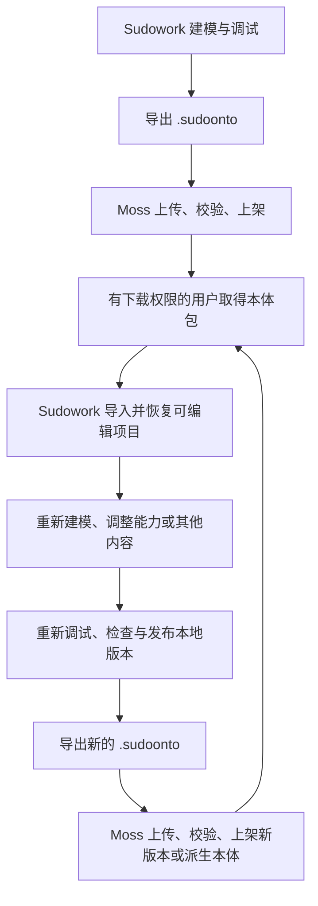
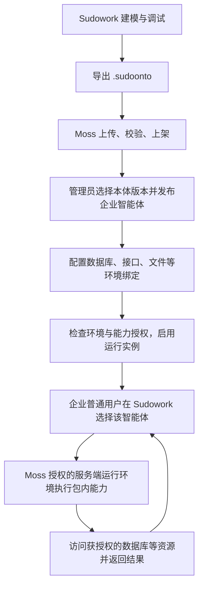

# Sudowork 本体包：双向流转与企业智能体交付

日期：2026-10-27。

客户端实施说明与当前包字段见 [Sudowork 本体包](../tech/sudoonto-package.md)。Moss 侧仍未开发；下文保留产品目标与验收依据。

本文记录最新确认的产品目标，补充[本体脚本运行与可移植运行包实施方案](./2026-10-26-ontology-script-package-design.md)。涉及包格式、客户端导入和 Moss 消费方式时，以本文为准。本文是实施要求，不表示这些功能已全部完成；代码现状见[当前设计与实现](../tech/ontology-workbench-current-design.md)。

## 1. 产品定位与实施范围

`.sudoonto` 是 Sudowork 客户端与 Moss 本体库之间统一的本体交付和流转格式，名称为“Sudowork 本体包”，内部采用 ZIP 容器。

客户端保留标准 RDF/OWL 文件导入导出、连接数据库建模等能力。不同建模输入最终进入统一的本体项目，不要求用户选择 RDF 项目或 Sudograph 项目。

| 交换格式 | 产品用途 |
| --- | --- |
| RDF/OWL 标准文件 | 与其他平台交换语义模型，导入后由用户或 AI 继续建模 |
| `.sudoonto` | 交付可继续编辑的本体，以及运行其能力所需的完整业务物料；用于客户端与 Moss 流转 |

建模、修改与调试在 Sudowork 完成。Moss 后续负责包上传、校验、上架、版本管理，以及基于包发布企业智能体。

当前需要完成客户端 `.sudoonto` 的导入、恢复编辑、调试与重新导出，并让包协议已经具备企业智能体部署所需的信息。Moss 本体库及企业运行流程后续实现；当前不建设 Moss 在线建模功能。

## 2. 链路一：下载、修改、再次上架

### 2.1 客户端导入的完成条件

导入后需要恢复的内容包括：

- 标准语义定义、IRI、命名空间，以及支持范围内保留的公理和未在图形编辑器展示的语义。
- 对象、属性、关系、数据映射和质量规则。
- 能力参数、实现源码、动作配置、函数之间的依赖。
- 可移植智能体定义及其指令、能力引用。
- 资源契约、绑定模板、运行要求和包内数据附件。
- 包的来源、原始本体身份、版本身份和内容摘要。

用户能够通过图形界面或 AI 修改恢复后的工作稿，再使用统一脚本链路调试。只把 ZIP 解压到某个目录并提供调用入口，不算完成客户端导入。

标准语义、编辑资料和运行投影必须对应同一份定义。可以复用同一份文件保存相关信息，不要求机械复制多份模型；存在生成投影时，需要记录来源并检查一致性，不能让导入恢复出的模型与正在运行的代码分叉。

导入默认创建本机项目实例，不覆盖其他项目。未绑定的数据资源应列为待配置项，不妨碍用户查看和编辑模型；具体能力是否可运行，由该能力的资源依赖决定。

### 2.2 修改后的版本关系

包需要区分：本体身份、内容版本、本机项目实例和 Moss 部署实例。

| 情况 | 版本处理要求 |
| --- | --- |
| 下载后原样导入 | 保留来源本体身份与内容版本；创建本机项目实例 |
| 未改变运行定义，只重新配置本地连接 | 连接配置留在宿主，不改写包的业务实现 |
| 修改对象、映射、规则、脚本或智能体指令 | 形成新的内容版本，并记录所基于的源版本或摘要 |
| 使用已有本体创建独立派生作品 | 创建新的本体身份，同时保留派生来源 |
| 再次上传 Moss | 根据发布者权限，登记为原本体的新版本或独立派生本体 |

包至少保留可追溯的来源身份和源版本摘要。是否有权发布到原本体名下，由 Moss 的登录身份和目录权限决定，包内元数据本身不授予发布权限。

已上架版本及其产物保持不可变。再次上架新版本不应直接替换旧版本的文件，也不应自动改变已有企业智能体绑定的版本。

## 3. 链路二：发布企业智能体，普通用户直接使用

这条链路的 Moss 产品功能后续实现，但当前 `.sudoonto` 必须包含可供该流程使用的模型、能力实现、智能体定义和环境契约。

### 3.1 普通用户的使用方式

普通用户在 Sudowork 中直接与企业智能体交互，不需要先下载本体包、导入工作台或在本机配置企业数据库。

能力在 Moss 授权的服务端运行环境中执行，使用目标环境提供的数据库连接和权限。数据库凭据不随智能体配置下发普通用户客户端，业务数据按授权以查询或动作结果的形式返回。

“有权使用企业智能体”和“有权下载、编辑本体包”是两种独立权限。链路二不能因为允许用户聊天，就自动给予链路一中的下载、修改和重新上架权限。

### 3.2 Moss 如何使用包中的智能体定义

包中保存可移植的智能体定义：名称与说明、指令、可用能力引用、执行要求。Moss 基于这些定义创建自己的企业运行实例，并绑定：

- 本体版本及运行内容摘要。
- 企业、发布者、可见性及使用权限。
- 数据资源绑定、凭据引用和资源访问权限。
- 目标运行环境、模型配置与允许执行的能力。

以上运行实例信息由 Moss 创建，不复用作者电脑上的智能体注册 ID、MCP 端口、会话或临时 token。

本体能力继续执行包内的同一套脚本和协议。企业智能体是否常驻属于 Moss 的运行管理，不要求每个本体额外启动 MCP Server，也不引入本体 Skill 发布层或专用原生工具适配器。

## 4. 当前 `.sudoonto` 必须具备的材料

| 材料 | 链路一用途 | 链路二用途 |
| --- | --- | --- |
| 语义模型与编辑资料 | 恢复建模，保留语义和业务意图 | 提供智能体理解业务范围的定义 |
| 对象、关系、映射和规则 | 继续调整数据绑定与业务模型 | 按发布版本访问和解释业务数据 |
| 能力目录、参数和输出契约 | 展示、编辑、调试能力 | 发现、校验和调用允许使用的能力 |
| 完整能力实现与代码依赖声明 | 修改后重建、调试和导出 | 在服务端执行相同业务逻辑 |
| 智能体定义及指令 | 继续调整智能体行为 | 创建企业智能体实例 |
| 逻辑资源 ID、来源类型、结构要求 | 在新客户端重新绑定资源 | 管理员配置企业数据库等资源 |
| 凭据字段声明与绑定模板 | 配置本机账号 | 对接 Moss 凭据管理，不携带作者密码 |
| 能力依赖与读写声明 | 判断哪些能力可运行 | 配置能力许可及资源权限 |
| 运行环境与依赖要求 | 检查本机是否可调试 | 判断目标运行环境是否兼容 |
| 身份、版本、派生来源及摘要 | 修改、分支和再次导出可追溯 | 版本登记、部署固定与升级管理 |
| 验证材料与验证范围 | 重新执行适用的验收 | 区分结构通过、待绑定和运行已验证 |
| 用户明确选择的数据附件 | 离线查看和调试 | 按部署需要提供初始数据或快照 |

“完整运行物料”指业务定义与执行材料齐全，不要求复制开发机、Electron、整个 node_modules 或 Python 虚拟环境。共享解释器和受支持依赖由客户端或服务器运行环境提供；不能打包的依赖必须明确声明。

真实数据库密码、API token、宿主凭据引用、个人会话、注册状态、缓存及调试临时文件不进入分发包。结构化配置和原始附件的处理边界需要分别说明，不能把“排除连接密码”描述为“所有文件已经自动脱敏”。

## 5. 环境绑定与企业数据访问契约

能力引用逻辑资源，例如 `business_db`；本体包固定该资源的类型及所需结构，宿主提供实际地址、账号和凭据。不同环境可以使用不同连接配置，但不能静默更换不兼容的数据源方言或字段结构。

同一包可以有以下绑定方式：

| 场景 | 绑定来源 |
| --- | --- |
| 作者在 Sudowork 调试 | 作者本机配置 |
| 另一用户下载后编辑 | 该用户自己的本机配置 |
| Moss 发布企业智能体 | 管理员配置的企业运行环境 |

包声明资源和能力需求；最终允许访问哪些数据、执行哪些动作，由宿主决定。数据库写操作同时需要动作许可及可写连接。模型提示词、请求中的企业 ID 或包作者的本机权限，不能代替服务器授权。

Moss 可以采用统一的只读业务账号，也可能需要按用户或角色限制数据访问，具体策略在 Moss 实施时确定。当前包协议必须保持绑定与宿主身份分离，不能将管理员全权限凭据或作者身份固化为能力运行前提。

携带 SQLite 等数据快照是可选项。链路二访问企业实时数据库不要求导出整库，也不要求把企业数据库同步到普通用户电脑。

## 6. 两条链路共用的约束

1. **运行一致**：本地调试、客户端重导入后运行、未来 Moss 运行使用相同的能力标识、参数语义和脚本实现；导出时不转换为另一套业务算法。
2. **编辑完整**：保留继续建模所需材料，不从一个有损的运行描述反推原始本体和源码。
3. **版本固定**：来源版本与修改后的新版本分开，运行实例引用明确的内容版本。
4. **环境独立**：部署绑定、凭据、权限和工作目录与包内容分开管理。
5. **校验分层**：包完整性、模型一致性、环境可用性、能力业务验收分别报告；缺少绑定可以导入编辑，但不能宣称已具备完整运行环境。
6. **导入可控**：导入阶段解析、校验并登记材料，不自动执行业务动作或安装脚本。
7. **标准交换保留**：客户端仍支持 RDF/OWL 标准文件；平台专有能力与环境材料由 `.sudoonto` 表达，不伪装成通用 OWL 语义。

## 7. 本轮客户端的验收条件

| 验收场景 | 必须达到的结果 |
| --- | --- |
| 标准模型接入 | 导入支持的 RDF/OWL 后，可通过用户或 AI 编辑、连接数据，再导出标准文件或 `.sudoonto` |
| 导出后脱离作者环境 | 移走原始数据源/源码后，携带足够附件的包仍可独立运行；外部资源明确报告待绑定 |
| 客户端 A → 客户端 B | B 导入后能恢复模型、映射、规则、源码、动作和智能体定义，而不只得到执行入口 |
| 原样再次导出 | 未修改运行定义时保留来源运行内容，不因本机安装路径、实例 ID 或凭据变化改写业务实现 |
| 修改后再次导出 | 形成新内容版本，保留来源关系；旧包及其固定版本不受影响 |
| 企业环境模拟 | 在独立目录按服务器资源绑定运行同一能力，不连接作者的桌面编辑服务或本体 MCP |
| 权限分离 | 包作者的可写配置不能直接授权目标宿主写库；未获授权动作不可执行 |
| 包内默认智能体 | 无需先注册作者本机智能体，包也具备未来创建企业智能体所需的定义 |
| 环境说明 | 明确标出所需解释器、代码依赖、资源绑定和实际验证范围 |

本轮可以用独立宿主运行测试验证链路二的包契约，不以提前实现 Moss 本体库、企业发布 UI 或租户智能体会话为完成条件。

## 8. 与当前代码的差距

当前实现已有标准语义文件导入导出、统一脚本执行、固定发布产物、运行包导出、资源绑定及底层解包校验。当前导出扩展名仍是 `.ontology.zip`，客户端完整包导入尚未形成产品流程。

后续客户端实现需要补齐：

- 将完整包产品格式统一为 `.sudoonto`，保留标准文件入口。
- 收敛建模入口到统一的本体项目，避免技术后端分支成为用户必须选择的项目类型。
- 包导入预检、项目创建、编辑资料恢复、资源重新绑定和能力调试。
- 完整的可移植智能体指令交付与恢复。
- 来源身份、版本及派生关系的持久化和再导出。
- 对上述双向流转及企业部署契约执行回归验收。

Moss 后续直接消费同一包协议，完成上传、校验、上架、版本与权限管理，以及企业智能体部署和客户端访问接入。
