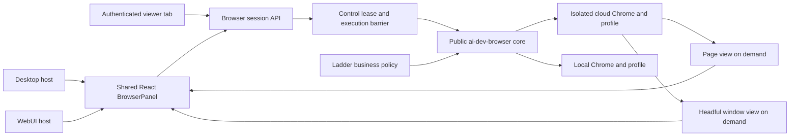
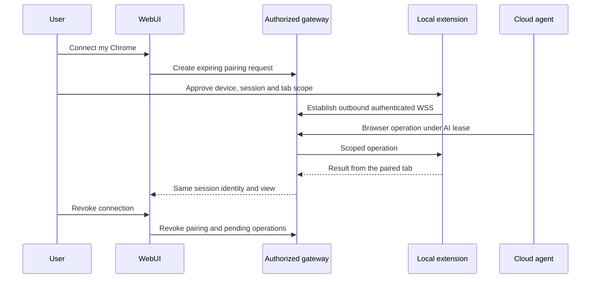
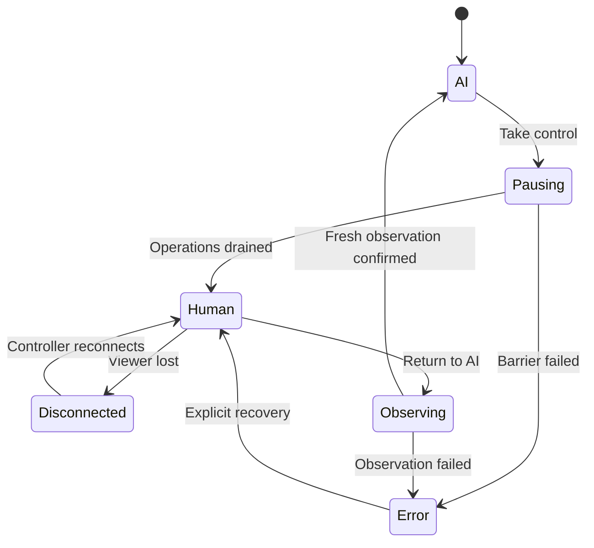

# Shared browser sessions for Desktop and WebUI

Status: cloud browser control, the shared panel, Desktop integration and compact takeover controls are merged. The initial v0.2.33 rollout passed actual Electron, Chromium and Firefox model/browser journeys with the public SDK v0.57.5. The 19 October production backend check found Moss 0.1.72; the termination repair for 0.1.73 is awaiting deployment. Viewer polling improvements are merged in SudoWork #1273. Existing personal Chrome passed a complete Electron/model journey with the candidate SDK; publication and application delivery remain open. The optional local extension relay and physical phone browser acceptance also remain open. This document is the source for [the shared design page](https://s.shareone.vip/md/sudowork-browser-sessions).

The 20 October round-two Desktop acceptance passed real-model launch, trusted AI input, compact controls, takeover, a separate viewer, exact Unicode human input, one submit, return, fresh model readback and shared slash commands. The host now tells models that screenshot pixels and browser input CSS pixels can differ and requires an explicit `devicePixelRatio` conversion. One pinned public SDK gap remains on macOS: its `SelectAll` input emits Control+A instead of Command+A, so the shortcut does not replace the focused field. The acceptance clears its owned fixture with acknowledged Backspace inputs; the SDK modifier mapping still requires an upstream release before that shortcut is ready.

## 1. Decisions

- Desktop and WebUI use the same React BrowserPanel and browser session contract. Hosts adapt authentication, execution and display transport.
- WebUI prefers managed cloud Chrome with the ai-dev-browser extension. Each user has an isolated, persistent profile; each running profile has one browser owner.
- The model chooses headless or headful using the task and reported capabilities. Connecting to an existing browser preserves its launch mode.
- Headless runs no Xvfb, x11vnc or websockify. A page viewer starts producing frames only while a viewer is attached. Headful uses an isolated display; window viewing and its proxy start on demand.
- Closing a viewer detaches display resources. It does not close Chrome, erase the profile or resume AI execution.
- BrowserPanel and a viewer in a separate local tab observe and control the same remote session. Neither requires the viewer device to run Chrome.
- Human control is a server-enforced lease. It applies across panels, viewer tabs, the main agent and all child agents sharing the browser.
- Public browser lifecycle, CDP, page display and window display belong in ai-dev-browser. Ladder retains billing, invitations, allowed sites and product policy.

## 2. Independent choices

Browser location, automation transport and display surface are separate choices. Headless is a launch attribute, not another transport.

| Host and browser location        | Automation                               | User display                             | Handoff scope                                      |
| -------------------------------- | ---------------------------------------- | ---------------------------------------- | -------------------------------------------------- |
| Desktop, local standalone Chrome | CDP                                      | Shared panel, native Chrome when headful | Main and child agents using that browser           |
| Desktop, existing local Chrome   | Extension                                | Shared panel and native Chrome           | Main and child agents; launch mode stays unchanged |
| Desktop, cloud Chrome            | Managed extension, explicit CDP fallback | Shared panel or remote viewer tab        | Cloud execution session                            |
| WebUI, cloud Chrome              | Managed extension by default             | Shared panel or remote viewer tab        | Cloud execution session                            |
| WebUI, cloud standalone Chrome   | Explicit CDP selection                   | Same shared panel/viewer                 | Cloud execution session                            |
| WebUI, user's local Chrome       | Authorized outbound relay to extension   | Same panel/viewer and native Chrome      | Explicitly paired local browser                    |

An Electron `<webview>` is a Chromium guest, not a DOM component available in ordinary browsers. The remote surface adapts this difference without duplicating tab, navigation or handoff UX.

### Implementation and acceptance coverage

| Browser path                     | Delivery and evidence                                                                                                                                                                                       |
| -------------------------------- | ----------------------------------------------------------------------------------------------------------------------------------------------------------------------------------------------------------- |
| Desktop local standalone CDP     | Implemented in [SudoWork #1250](https://github.com/sudoprivacy/sudowork/pull/1250); actual Electron/model takeover, compact controls and same-session commands passed.                                      |
| Desktop app-managed extension    | Public worker support exists. SDK and cloud signed-extension tests do not establish complete Desktop extension application acceptance; that journey remains open.                                           |
| Desktop existing personal Chrome | Explicit selection, four real host/crash-recovery journeys and a complete Electron/Sonnet handoff passed. SDK 0.58.0 is published; application delivery remains open.                                       |
| Desktop cloud Chrome             | Shared renderer and cloud dispatch exist. A complete Electron-to-cloud browser application journey remains open.                                                                                            |
| Shared cloud extension and CDP   | Implemented in the public worker, Moss and shared panel. Real model/file/reconnect and explicit transport-switch journeys passed against the production backend; public frontend rollout is recorded below. |
| WebUI local extension relay      | Optional planned capability with explicit pairing and revocation.                                                                                                                                           |
| Viewing clients                  | Real Chromium and Firefox 155 on Windows passed. Physical phone and Safari acceptance remain open; desktop testing does not establish either result.                                                        |

## 3. Architecture

SudoWork owns user authorization, conversation-to-browser binding, runtime deployment, agent execution barriers, the shared panel and file transfer UX. The public core supplies browser identity, lifecycle, capabilities and the display adapters extracted from ladder.

Both AI tools and human input resolve the same browser/session/profile/tab identity. A viewer is never a second browser or a separate login.

## 4. Managed cloud runtime and resource use

1. The authenticated runtime resolves the tenant, user, profile and execution session. User-supplied filesystem paths or arbitrary remote debugging URLs are not accepted as session identity.
2. A single browser process owns a profile directory. Concurrent requests attach to that process; another execution session queues or explicitly creates another profile.
3. Launch mode is selected before starting Chrome. Mode changes require an explicit restart and a warning that in-memory page state may be lost. Persistent profile data remains.
4. Headless starts Chrome and the extension/control bridge only. No desktop display service is provisioned.
5. A page viewer attaches when the user opens the panel or viewer tab. Frame production stops when the last viewer detaches. Background automation can continue under the AI lease.
6. Headful starts an isolated X display and window manager with Chrome. The public window adapter captures the same display and forwards native input through the authenticated gateway while viewers are attached. The managed deployment needs no separate VNC service. Ladder's existing VNC adapter remains available for deployments that use it. Detaching the last viewer stops frame production; the X display and Chrome continue for the headful session.
7. End-session shuts down the owned browser and runtime resources; ordinary viewer disconnect does not.

Bounded frame rates, shared frame production, backpressure and visible-tab subscriptions prevent one encoder/polling loop per viewer. Idle profiles consume storage; they do not require running Chrome. Reaping must preserve the profile and leave a recoverable stopped state.

### Production extension compatibility

Recent headless Chrome can run extensions, but packaged Chrome installation must be verified separately from Chrome for Testing. Branded Chrome 137+ removed `--load-extension`; production needs a supported installation method and a successful extension handshake. Do not silently label a CDP-only browser as extension-connected.

Expose browser version, actual transport, headless state, `pageView`, `windowView`, extension connection and profile persistence in capabilities. A missing extension produces an actionable reconnect/install error. CDP fallback requires explicit selection.

## 5. Cloud sign-in and the local profile

The cloud browser can offer **Sign in to cloud Chrome** during human control. The user chooses whether to save or sync browser data in their Google Account. Chrome documents account-backed bookmarks, passwords, extensions and settings, plus optional history and tabs. See [Chrome account data](https://support.google.com/chrome/answer/165139?hl=en).

This creates a cloud profile. It does not establish access to the existing local profile. Website cookies, local storage, device-bound credentials, installed extension state and local files must not be assumed to transfer. A user may still need to log in to individual websites on the VM. Never copy an open local Chrome profile directory into the VM.

Offer two explicit choices:

- **Cloud browser**: persistent isolated profile; the user signs in to sites or optionally Chrome on the VM.
- **Connect my Chrome**: pair the local extension through an authenticated outbound relay when exact local login/device context is needed.

Cloud sign-in is a useful first path, not a replacement for the local relay.

The user signs in through the authenticated window viewer while holding human
control. Use the VM's persistent isolated profile, and offer the same panel and
separate viewer tab. A separate native VNC client is not required. VNC is an
available display adapter; a production host must authenticate the viewer and
encrypt and authorize its connection rather than expose a raw desktop port.
The current managed deployment already transports window frames and input
through the existing authenticated session API. Chrome account sign-in and
website sign-in remain separate user choices; neither imports all local state.

## 6. Local extension relay

Pairing binds tenant, user, device, execution session, allowed browser/tab scope and expiry. Revocation is immediate. The extension makes an outbound connection; no public local CDP listener or inbound router configuration is required. Existing Chrome keeps its headless/headful mode. Reconnecting proves the same browser identity or asks the user to pair again.

## 7. User handoff UX

The panel and viewer tab share the same status and actions. A compact session control also remains available outside BrowserPanel so users of native Chrome can hand off explicitly.

| State                                 | What the user sees                             | Controls                                              | What AI receives                                        |
| ------------------------------------- | ---------------------------------------------- | ----------------------------------------------------- | ------------------------------------------------------- |
| Stopped                               | Browser is not running                         | Start; transport and mode selection                   | Start capabilities and no active target                 |
| AI control                            | AI is controlling this browser                 | Take control; observe; open viewer                    | Current lease and target identity                       |
| Pausing                               | Waiting for the current operation to stop      | Cancel request if no lease has transferred; view only | New writes blocked; in-flight completion required       |
| Human control                         | You are controlling this browser; AI is paused | Navigation, typing, tabs, uploads; Return to AI       | Waiting state, reason and control epoch; no retry loop  |
| Returning                             | Reconnecting and observing the current page    | View only; cancel continuation                        | Fresh observation required; prior queued writes invalid |
| Disconnected while human owns control | Connection lost; AI remains paused             | Reconnect; explicit end or return after reconnection  | No automatic lease transfer                             |
| Error or uncertain execution          | Operation status could not be confirmed        | Inspect/reconnect/end; no unsafe automatic retry      | Structured failure and observation requirement          |

### Taking control

1. The user clicks **Take control** in the panel, viewer or session control.
2. The server advances the control epoch and blocks new AI operations from the main agent and children. Queued actions from the earlier epoch are discarded.
3. An already-running atomic input sequence finishes, including mouse/key release. For unisolated Desktop shell access, the runtime must stop all affected tool execution and verify no browser operation remains active. A UI-only pause cannot grant the human lease.
4. Only after that barrier succeeds does the UI show **You are controlling** and enable human input. Failure leaves input disabled with a clear retry/end action.
5. The user completes login, consent, CAPTCHA or another manual step in the same tab and profile. Native windows and window-view Chrome settings are covered by the same explicit lease.

### Returning to AI

1. The user clicks **Return to AI**; optional text explains what they changed.
2. Human input is disabled and the control epoch changes again.
3. The runtime obtains current tabs, active target, URL and a fresh screenshot/DOM observation. It rejects actions planned against the old target or epoch.
4. The agent receives a continuation message: human control ended, what the user reported, current target identity and an instruction to observe before acting.
5. Execution resumes after the observation barrier. It does not replay a stale submit, purchase, navigation or click.

Closing a tab/window, losing connectivity or a browser timeout never silently returns control to AI. Another viewer can observe but cannot replace the human controller without explicit authenticated transfer. Manual input outside the panel requires the same explicit handoff; do not imply that arbitrary OS input is automatically detected.

## 8. LLM and tool contract

Tools return structured state with `browserSessionId`, browser identity, `profileId`, active `targetId`, `controlEpoch`, `targetEpoch`, controller and capabilities. Each write must match the current lease and epochs.

- During human control, tool requests return `browser_control_held_by_user` with a wait instruction. They do not poll, recreate the browser, switch profiles or use a different transport to bypass the lease.
- The agent explains why human input is needed through its native question/options or ordinary conversation. For example: "Please take control of the browser and sign in. Choose Return to AI when ready." No separate custom question interface is required.
- The user establishes ownership with the shared Take control action. A native option or a typed "done" message alone is not proof of a control transfer. If a future native option performs the transition directly, it must call the same authenticated host action and wait for the tool barrier acknowledgement.
- After return, the first operation is a fresh observation. A child agent cannot use a cached screenshot from before handoff.
- Read-only access is an exact allowlist. Arbitrary JavaScript evaluation is a write because it can change page state. Closing, restarting, navigating and changing tabs are also writes.
- Cancellation and session termination remain available while paused. They do not transfer control or imply that an uncertain write had no effect.
- Avoid model calls while waiting. Notify the agent on a state change instead of repeated tool failures.

Agent shell access must not expose an unrestricted browser endpoint or the human controller's credential. Cloud runtime isolation puts browser control behind the broker. Desktop uses the conservative all-tools pause until equivalent isolation is established for every supported ACP host.

## 9. Shared panel and viewer behavior

- Tabs, title, URL, back/forward/reload, transport/profile status, handoff, reconnect and error UX are shared components.
- Desktop standalone Chrome and cloud Chrome use the same public page surface. The native Desktop Chrome window remains available when headful. Cloud headful window view exposes Chrome UI when needed, including profile sign-in and extension management.
- Opening a viewer tab uses the existing authenticated session. Credentials are not placed in the URL. A copied link requires login and current session permission.
- Target changes advance `targetEpoch`; stale frames and input are rejected. Coordinates are calculated from the actual remote viewport, including resizing and mobile touch input.
- Reconnection verifies browser identity. It never attaches silently to another user's browser or starts a replacement because a transient connection failed.
- Uploads and downloads belong to the same authenticated session. Desktop picks local files; WebUI stages files through authorized upload/download routes. Cloud pages cannot read arbitrary viewer-device paths.
- Page view and window view are two surfaces of the same headful browser. Headless has page view only; requesting Chrome UI requires an explicit headful restart.

## 10. Acceptance and rollout

Acceptance covers actual browser behavior and actual AI execution. A fake model or standalone display primitive test does not prove the application handoff.

| Journey                          | Required evidence                                                                                                                 |
| -------------------------------- | --------------------------------------------------------------------------------------------------------------------------------- |
| Desktop local CDP and extension  | Real AI tool use, same-profile login, take/return control, child-agent barrier and fresh observation                              |
| WebUI cloud extension, headless  | Real extension handshake, panel and new-tab viewer share the same target, no display processes while idle                         |
| WebUI cloud extension, headful   | Actual managed Chrome install, window viewer trusted input, sign-in UI reachable, lazy viewer lifecycle                           |
| User isolation and persistence   | Two authorized users cannot view/control each other; cookies/profile survive owned restart; concurrent profile ownership enforced |
| Handoff races and recovery       | In-flight operation drains; stale action rejected; disconnect stays paused; reconnect and return observe current page             |
| Files and multiple tabs          | Session-bound upload/download, popup/tab identity and stale frame/input handling                                                  |
| Local relay                      | Real local extension pairing, authorized scope, same local profile, revoke/disconnect, no inbound CDP port                        |
| Mobile and browser compatibility | Real phone interaction plus Safari/Firefox/Chrome viewers; desktop emulation alone is insufficient                                |

Use the repository live workflow and real model credentials. Prefer live PTY for model/runtime journeys, real Chrome for UI, and local Docker or the restricted production VM for infrastructure. Commit locally-run live tests and add suitable regression coverage to CI. Preserve failed evidence, clean only owned fixtures, and report any remaining acceptance gap explicitly.

### Completion checklist, 19 October 2026

This checklist tracks implementation and actual application acceptance separately.
An older passing journey is not counted as a new release's complete acceptance.

| Work                           | Current status                                                                                      | Required evidence before closing                                                                                                                    |
| ------------------------------ | --------------------------------------------------------------------------------------------------- | --------------------------------------------------------------------------------------------------------------------------------------------------- |
| Headful viewer responsiveness  | PR #1273 merged; measured candidate improvement; public post-upgrade lifecycle retest awaits review | Actual authenticated WebUI render cadence and exact trusted Unicode input, before/after comparison, reconnect and hidden-view regression protection |
| Native handoff communication   | Desktop real native question, pause, persisted cancellation and return passed                       | Real agent explains handoff, acknowledged host pause, user return and fresh model observation                                                       |
| Desktop managed extension      | Application acceptance open                                                                         | Electron application with actual installed extension, same profile and handoff                                                                      |
| Desktop personal Chrome        | Actual Electron/model journey and public SDK host cases passed; application delivery open           | Deliver the application pinned to the verified public SDK                                                                                           |
| Desktop cloud Chrome           | Application acceptance open                                                                         | Complete Electron-to-cloud session journey                                                                                                          |
| Cloud profile login            | Remote viewer implemented; dedicated sign-in workflow acceptance open                               | Human enters an isolated fixture login, restart preserves that login, AI observes the same signed-in session                                        |
| Other agent hosts              | Capability-specific acceptance open                                                                 | Each supported host acknowledges its tool barrier; unsupported active hosts cannot grant human control                                              |
| Physical iPhone remote browser | Open                                                                                                | Real device take, Unicode input, return and exact model readback; prior phone screenshot only proves model/send                                     |
| General production rollout     | Scoped to three owners, including the nominated owner                                               | Complete scoped acceptance and verify deployment-wide owner isolation before expansion                                                              |
| WebUI local extension relay    | Optional capability, still open                                                                     | Pairing consent, same actual local profile, scope, revoke/disconnect and real cloud-agent acceptance                                                |

The 19 October isolated production-image measurement used actual managed
headful extension Chrome at 1280 by 900. VM-local frame latency was 42.14 ms
median and 158.69 ms P95 across 12 samples; native address-bar focus, text and
Enter took 268.5 ms together. These are backend measurements, not end-user
render latency or proof of smooth interactive viewing. The owned container was
removed. Current native window frames use the public X11/JPEG/input adapter;
they do not start Ladder's noVNC server.

The public WebUI baseline then passed the actual fixture login workflow at
0.77 rendered/distinct frames per second, with a 1346.2 ms median frame interval
and 1645.71 ms click-to-visible login feedback. The candidate SPA, against the
same real production APIs and Chrome, reached 2.63 rendered and 2.44 distinct
frames per second, a 345.8 ms median interval and 820.41 ms login feedback.
Unicode input was exact and submitted once. Stop released the owned Chrome,
Return released the persistent human lease and a real model acknowledged the
return note. The temporary key was revoked. Follow-up verification found that
an acknowledged conversation termination could race with recovery and reactivate
the old session. [Moss #410](https://github.com/sudoprivacy/moss/pull/410) repairs
that durable termination guard. Production Moss was upgraded to 0.1.73 on
20 October with the published, checksum-verified server package and its tagged
host installer. Browser policy, Nexus connections and existing users were
preserved. The public cleanup regression remains open: reading the old owned
fixture with a raw API key as a bearer token returned HTTP 401, so that attempt
stopped and its temporary key was revoked. Correcting the key login flow awaits
the user's required review.
This improves the polling path but does not establish smooth full-motion
viewing. The live journey is `live_browser_view_performance.py`; the candidate
measurement is not a claim that this change has already been deployed.

### Personal Chrome application acceptance, 19 October

The full Electron application used a normally built SDK 0.58.0 candidate wheel
and an actual SudoRouter Sonnet 4.6 account. The user explicitly selected the
running extension's profile through BrowserPanel, then returned control with the
task. The model observed and edited that exact browser. Human takeover paused
agent tools, and the separate viewer accepted Unicode input and one trusted
submission. After Return, the finished assistant reply reported the exact human
value and page status. Shared browser commands reached the same page. Explicit
disconnect and normal application shutdown left Chrome running with its state.

The live journey also found and repaired a shared layout bug: a panel at 100%
height added its padding outside that height, clipping its bottom input. Both
the panel and compact controls now include padding in their declared height;
the handoff note sits next to the return controls. The live UI driver requires
enabled, hit-tested fields fully inside the viewport, and reads actual assistant
messages rather than echoed prompts or tool results.

[SDK 0.58.0](https://github.com/sudoprivacy/ai-dev-browser/releases/tag/v0.58.0)
is now published on GitHub and PyPI. All 199 packaged runtime files match the
tested candidate byte for byte. Four host journeys then passed against the
actual public PyPI distribution in an isolated environment, without source-path
overrides. The application pins the matching public tag; its release remains
open.

### Native question takeover acceptance, 20 October

A real Electron/Sonnet journey reproduced a stale question after acknowledged
takeover: the composer kept treating new chat input as the abandoned answer.
Takeover now uses the same pending-request cancellation as Stop. The host's
question cancellation reaches persistence and the renderer after turn
cancellation; late agent output remains suppressed. Partial cancellation
updates preserve the original question and its options.

The repeated real journey passed a native question, acknowledged takeover,
persisted cancellation across a full renderer reload, trusted Unicode input
and one submission through the independent viewer, then an exact model readback
after Return. Chrome remained alive after explicit disconnection and normal
application shutdown. Two ordinary CI regressions protect cancellation
persistence and the suppression of late agent messages. The live journey uses
`live_shared_browser.py --pending-native-question`.

### Delivery already completed

- [SudoWork #1227](https://github.com/sudoprivacy/sudowork/pull/1227): ai-dev-browser v0.52.1 baseline and live CI prerequisites; merged.
- [ai-dev-browser #15](https://github.com/sudoprivacy/ai-dev-browser/pull/15): mode guidelines and browser session lifecycle; merged source.
- [ai-dev-browser #14](https://github.com/sudoprivacy/ai-dev-browser/pull/14): public CDP, page surface and VNC primitives, actual-browser regression tests and lifecycle/proxy fixes; merged, nine CI jobs passed.
- [Ladder #48](https://github.com/elfenlieds7/ladder/pull/48): use the public primitives and remove duplicated viewers; merged, 59 private tests passed.

### Validated delivery in progress

- [ai-dev-browser #19](https://github.com/sudoprivacy/ai-dev-browser/pull/19) is merged and released as v0.54.0. It provides the managed signed Chrome runtime, shared control and authenticated page views.
- [ai-dev-browser #20](https://github.com/sudoprivacy/ai-dev-browser/pull/20) is merged and released as v0.55.0 on GitHub and PyPI. It adds the isolated X11/Openbox window surface, native tab selection and Unicode input. Real VM CDP and signed extension journeys passed. Both ordinary Windows installed-profile modes passed explicit restart and stale-session rejection. All ten CI checks passed before merge.
- [ai-dev-browser #21](https://github.com/sudoprivacy/ai-dev-browser/pull/21) is merged and released as v0.56.0 on GitHub and PyPI. It adds native file-chooser uploads and completed downloads with opaque IDs, size and SHA-256. Real Chrome and signed extension acceptance passed, including Unicode filenames, trusted change events, stale requests, host file boundaries and exact downloaded bytes.
- [Moss #374](https://github.com/sudoprivacy/moss/pull/374) is merged. It implements authenticated owner profiles, scoped HTTP MCP, shared browser control and automatic handoff notification. Real VM tests confirmed user isolation, exclusive profile ownership, conversation transfer, discovery without allocation and restart recovery. The signed 0.4.1 to 0.4.2 upgrade preserved the profile, cookie and human lease through subsequent crash recovery; this live journey is also in CI.
- [SudoWork #1239](https://github.com/sudoprivacy/sudowork/pull/1239) is merged. It implements the shared page/window panel and authenticated viewer. Actual built WebUI, Moss/Nexus, ACP scode, real SudoRouter gpt-6-luna and Chrome passed headless and headful automatic handoff. The human operated the native Chrome address bar, entered a random value, and returned control. The AI observed that value and submitted exactly once with a trusted click and the original cookie; browser/profile identity stayed constant and there were no page errors. The committed live test supports remote fixtures and native window acceptance.
- [Sudo Code #944](https://github.com/sudoprivacy/sudocode/pull/944) is merged and included in stable v0.2.30. HTTP MCP capabilities and headers reach the engine, and native MCP images reach the model. The published nightly and RC passed real API browser workflows and the repository's live PTY image journey before promotion on the same commit. The matching co-host release pairs the engine with Nexus 0.8.14.

### Explicit browser lifecycle

While holding control, the user can select headless/headful and extension/CDP,
then choose Restart. A confirmation explains that unsaved page state will be
lost while the persistent profile and login cookies are retained. Stop has its
own confirmation and releases Chrome and its display while retaining the human
lease. Return to AI remains available while stopped; it sends the user's note
and a fresh stopped-state observation without restarting Chrome. The AI chooses
whether to launch again according to the task and the user's instructions.

Restart and Stop pass through the same write gate as page operations. They
advance the epochs before changing Chrome, so input from the previous browser
cannot reach its replacement. A failed or uncertain stop cannot launch a second
Chrome against the same profile. Older backends omit the lifecycle capability,
so the shared panel shows the controls only when the backend supports them.

[Moss #375](https://github.com/sudoprivacy/moss/pull/375) adds these lifecycle
operations to HTTP and MCP. Real Windows Chrome, both VM transports, mode
changes and a real ACP model journey passed. The shared panel's live acceptance
also passed with actual UI controls, persistent cookies across extension/CDP,
and a first AI turn triggered by Return while Chrome stayed stopped. WebUI
attaches the conversation stream before sending the handoff, so this first turn
is visible without an earlier chat message. The committed live journey is
documented in `apps/webui/tests/e2e/README.md`.

Moss #375 and [SudoWork #1243](https://github.com/sudoprivacy/sudowork/pull/1243)
are merged after all applicable CI passed.

### Session files

The same shared panel handles files on Desktop and WebUI. A native page file
chooser exposes a request ID and single/multiple selection mode. The user
takes control, selects files on their device, and the authenticated host stages
bytes in the isolated browser profile. Attachment uses the exact chooser and
control/target epochs. Switching targets, restarting or returning control
invalidates the old request. Each file is limited to 16 MiB; a multiple chooser
accepts up to 20 files.

The viewer lists completed downloads by filename. Saving one uses the current
authenticated session, checks its size and SHA-256, and saves it on the viewer's
device. The browser profile retains completed files and IDs across restart.
Neither viewer nor model receives a VM filesystem path. Managed extension
upload explicitly enables Chrome file access only in the owned isolated
profile while Chrome is stopped.

[Moss #377](https://github.com/sudoprivacy/moss/pull/377) provides authenticated
byte transport. Actual Windows Chrome and VM CDP/extension file journeys
passed and are protected in CI. The shared application's committed live
journey drives a real model, human takeover, native local file selection,
server receipt, automatic return, AI download and local save. It verifies
Unicode filename/content, login cookie, trusted upload event, unchanged
browser/profile identity, stale/anonymous rejection and exact download bytes.

### Public worker and production delivery

- [ai-dev-browser #23](https://github.com/sudoprivacy/ai-dev-browser/pull/23)
  is published as v0.57.2. The public worker CLI owns browser lifecycle,
  profile locking, files and control journals. Moss consumes this worker rather
  than maintaining a private copy. Real native Chrome and signed managed
  extension journeys passed, including an existing profile and human lease
  surviving the consumer upgrade.
- [ai-dev-browser #24](https://github.com/sudoprivacy/ai-dev-browser/pull/24)
  is published as v0.57.3. The shared viewer preserves selection modifiers and
  maps Ctrl+A/Cmd+A to SelectAll. Actual viewer keyboard input replaces an
  AI-populated field with Unicode text and submits exactly once. Extension CI
  uses its configured startup budget and retains connection timing diagnostics.
- [ai-dev-browser #25](https://github.com/sudoprivacy/ai-dev-browser/pull/25)
  is published as v0.57.4. Status reports `pausing` while a browser starts,
  stops or rebinds, preserves the human lease, and disables page/window input
  until completion. It avoids querying a retiring driver without reconnecting
  or replaying any action. Native Windows headless/headful journeys, eight
  signed managed Chrome VM journeys and all ten CI jobs passed. The Moss
  consumer's six actual Chrome journeys also passed with the official wheel.
- [ai-dev-browser #26](https://github.com/sudoprivacy/ai-dev-browser/pull/26)
  is published as v0.57.5. Concurrent status readers retain human control and
  page capabilities; only actual browser start, stop and rebind operations
  report a lifecycle transition. Two real regressions failed before this fix.
  Native Windows headless/headful, eight signed managed Chrome journeys and
  all ten PR checks passed. Six Moss consumer journeys also passed with the
  official PyPI wheel, including eight concurrent status reads during human
  control. The production component upgrade retained Moss 0.1.59, its runtime
  pin, all 116 user configurations and the existing profile volume. Readiness
  and actual Nexus VFS/Vault persistence checks passed.
- [Moss #381](https://github.com/sudoprivacy/moss/pull/381) is released as
  server-v0.1.58 and deployed to the production VM. Its configured managed
  browser image uses public SDK v0.57.2. The server upgrade preserved all 116
  user configurations, the owned browser profile volume, CA/master key/plugin
  identities and existing runtime pods. Readiness and an actual Nexus VFS/Vault
  persistence check passed. Browser acceptance through the public service is a
  separate check from this deployment receipt.
- The managed browser component was subsequently upgraded independently to
  public SDK v0.57.4, retaining Moss 0.1.58 and its runtime pin. The browser
  client and adapter sources are unchanged in the subsequent Moss 0.1.59 release.
  The upgrade retained the existing profile volume, all 116 user configurations
  and CA/master key/plugin identities. Readiness and actual VFS/Vault
  persistence verification passed. The new worker reports the official wheel
  version and its verified image digest; headless startup runs no display
  processes.
- [Moss #382](https://github.com/sudoprivacy/moss/pull/382) is released as
  server-v0.1.59 and deployed. It consumes the public browser worker and
  [user-runtime SDK v0.1.2](https://github.com/sudoprivacy/sudostack/pull/48).
  The latter renews credentials through the runtime account's existing patch
  permission with UID, resourceVersion and owner checks. A real large-history
  Secret test passed without update permission or RBAC changes. All four
  previously failing active-owner upgrades then succeeded; every retained PVC
  kept its UID. The server cutover preserved 116 user configurations and actual
  Nexus VFS/Vault contents, with Moss 0.1.58 retained for rollback.
- A complete file handoff passed through the public production Moss backend
  with the locally built WebUI and real gpt-6-luna: native Unicode file
  selection, trusted upload, exact downloaded bytes, retained login cookie,
  stale upload 409, anonymous upload 401 and no page errors. The extended
  journey closed the original chat, returned from the independent viewer,
  and reloaded the reopened chat with an actual single-use approval pending.
  Its restored visible approval allowed the AI to finish the trusted download
  without another submission. [SudoWork #1251](https://github.com/sudoprivacy/sudowork/pull/1251)
  contains the subscription barrier, writer retention, permission replay and
  the locally executed live test. The subsequent public frontend deployment
  and its actual acceptance are recorded below.
- The extended production-backend journey also passed the actual shared page
  keyboard path: AI prefilled a field, the user replaced it through Ctrl+A and
  trusted Unicode input, and the returning model reported the exact new value.
  The downloaded receipt contained the real uploaded bytes and edited text,
  matching all 80 bytes and SHA-256. Independent-viewer Return and recovery of
  the pending single-use approval remained enabled in that same journey.
- [SudoWork #1249](https://github.com/sudoprivacy/sudowork/pull/1249) fixes the
  WebUI release container's shared browser adapters. A real container with
  PostgreSQL, migrations, authentication and viewer assets passed locally.
- Sudo Code stable and co-host v0.2.31 provide the acknowledged execution
  barrier. Real API/live PTY checks covered foreground tools and a parent/child
  tool tree; cancelled work stays cancelled after admission reopens.

### Shared input delivery

Desktop and WebUI use one acknowledged input queue in BrowserSessionPanel.
Clicks, selection shortcuts and Unicode insertion reach the browser in their
original order even when an HTTP request is delayed. Navigation and Return
wait for queued inputs. Each queued input retains its observed browser,
profile, generation and control/target epochs; a changed observation cannot
silently redirect an old action to a new tab or browser.

The real managed Chrome/model regression reproduces the former failure by
delaying the first human page click by 450 ms. The old implementation allowed
selection and typing to overtake the click. A matching component regression
also failed before the repair and protects ordered input before Return in CI.
After the repair, the entire real model journey passed with this delay on
production Moss 0.1.59 and SDK 0.57.5: trusted Unicode replacement and upload,
independent-viewer Return, restored single-use permission after reload, exact
model readback and the downloaded receipt's bytes/SHA-256. The owned completed
test conversation was terminated through its normal owner API.

Download history and tab lists have bounded, independently scrollable areas.
The page surface retains a minimum usable height. A real Firefox journey
previously failed when a retained download list consumed the panel and clipped
trusted page clicks. After the layout repair, the entire model/file/reconnect
journey passed with the same profile and 14 retained downloads; Chromium also
passed with 15 retained downloads. The live test
requires at least 95% of the page image to be visible before page input and
records the retained history count.

The same full journey also passed with a real Firefox 155 client on Windows.
Firefox displayed and controlled the VM's managed extension Chrome through
the shared panel. Trusted field preparation, the value at human focus,
Unicode replacement, independent-viewer Return, recovered permission, visible
model readback and exact file bytes were verified with a 450 ms delayed click.
The reusable live test selects the client with `--client-browser`.

### Desktop acceptance and remaining scope

The Desktop integration uses the public v0.57.5 worker behind authenticated
HTTP MCP, with a stdio adapter for engines without HTTP MCP support. Tool
discovery and an idle panel allocate neither Python nor Chrome. The first
browser operation prepares an app-owned Python environment. Desktop defaults
to standalone CDP and lets the model choose headless/headful.

A real gpt-6-luna conversation in the built Electron app passed headful launch,
shared panel and separate native viewer, acknowledged human takeover, exact
Unicode input and a trusted submission. Return triggered a new model turn that
observed the human value and page status, without replaying the submission.
The existing `/browser status` and `/browser eval` commands used that same
session. A separate real restart journey recovered persisted human control
through an explicit return. These application checks complement the Windows
and Linux real-Chrome host/stdio CI workflow; the model journey remains an
explicit local test with actual credentials.

Packaged Desktop includes both browser MCP adapters. The packaging hook rejects
a missing or empty adapter before signing or publishing on every platform.
The production build compiles and validates both adapters before using any
cached application output. With both generated files absent, the former build
still exited successfully without creating them; the repaired build generated
the same adapter bytes as the installation used by the actual Chrome journeys.
The actual pre-fix Windows installation failed with a missing `shared.js` when
started through its Electron executable in Node mode. The repaired installation
passed real headless and headful Chrome/stdio journeys through that same
packaged path, including authenticated discovery without allocation, takeover,
trusted input, exact file bytes and shutdown. The reusable native live journey
accepts `--packaged-resources` and `--electron-executable` for this verification.

The shared panel also supports a compact control surface without pixel
streaming. Desktop opens it as an always-on-top window, allowing Take control,
a handoff note and Return to AI while BrowserPanel is hidden. Open viewer uses
the same session and trusted desktop bridge. The real Electron/model journey
passed with official SDK 0.57.5: native window metadata, hidden BrowserPanel,
trusted Unicode replacement, one submission and exact model readback.

Desktop managed profiles currently persist per conversation; cloud profiles
persist per user with exclusive ownership. Desktop connection to an existing
user Chrome profile is being delivered through [SDK #32](https://github.com/sudoprivacy/ai-dev-browser/pull/32).
The host offers **Connect my Chrome**, inspects the currently connected extension,
shows its opaque profile identity and waits for explicit confirmation. It pauses
all registered agent tools before connecting. The shared panel and native viewer
use that same session. Launch mode can be unknown and is preserved; personal
attachment cannot restart Chrome or reconfigure its downloads. Disconnect retains
Chrome, tabs and cookies, and keeps agent tools paused until explicit Return.

Four real Desktop host journeys passed with both extension WebSocket backends
and headless/headful fixture Chrome. A cookie seeded before host attachment,
trusted Unicode input, one submission, observation after Return and preserved
Chrome/cookie/input after host shutdown were verified. The fixtures reuse the
pinned public SDK's actual extension setup. They do not run a model or Electron
renderer. The full `live_shared_browser.py --existing-profile` application
journey must pass before this capability is accepted and released.

The authorized local extension relay and actual phone/Safari acceptance remain
open. These capabilities must each have their own
implementation and evidence before this design is considered fully delivered.

### Public WebUI deployment and acceptance

On October 15, 2026, [the final image build](https://github.com/sudoprivacy/sudowork/actions/runs/38685336013)
published source `96e8ea412a6d44d1509d4046b116e1215cae1b7d`, whose Git tree is
identical to merged #1254 and tag v0.2.33. The accepted deployment image is
`sha256:c45c01af59f94f4efd0567f0943951a4bfff8e8f0319d010248259ec4491202d`.
The application replacement retained the PostgreSQL container/volume, gateway,
TLS files, encryption keys, original conversation lock states and 759 old
hashed assets. Its previous image and a consistent database backup remain
available for rollback. No database backup was restored during the upgrade.

An original browser window reloaded the new public application without logging
in again: the user and cookie were unchanged, and its old JavaScript asset
returned the original bytes and SHA-256. The check waits for visible application
readiness and verifies identity explicitly; background polling makes network
idleness unsuitable as the completion condition.

The complete live file journey passed in real Firefox and Chromium at
[the public WebUI](https://webui.sudoprivacy.com) with real gpt-6-luna and the
production managed extension Chrome. It verified actual AI prefill at human
focus, trusted Unicode replacement with a 450 ms delayed click, native file
selection/upload, independent-viewer Return, recovery of a pending single-use
permission after chat reload, completed and visible model readback, one
submission and the exact 80-byte downloaded receipt/SHA-256. Anonymous and stale
uploads returned their expected 401/409 responses, with no page errors. The
completed owned conversation was terminated through its normal owner API;
persistent profile data was retained.

The public lifecycle journey also passed headful extension startup, a headless
restart, explicit headful CDP, persistent login cookies and display release.
Normal one-time permissions were answered through the real chat UI; the AI
continued automatically after Return while Chrome remained stopped. The live
test makes the initial stopped profile and transport explicit and shares the
permission handler with file acceptance.

[Formal v0.2.33 release](https://github.com/sudoprivacy/sudowork/actions/runs/38694947513)
passed Windows, both Mac architectures and both native WebUI architectures.
The published Windows ZIP matched its GitHub asset digest and passed headless
and headful journeys using its packaged executable and browser MCP resources.
The previous v0.2.32 publication was cancelled after the missing-resource defect
was found; the v0.2.33 packaging guard and clean compilation repair were verified.

The handoff live test has an external-human mode for a real phone viewer. It
prints a scoped viewer URL and a random value, then requires the actual person
to take control, enter that value and return to AI. Exact model readback,
trusted submission, shared identity and restored history remain required.
The complete mode passed a real-model preflight with a separate Chromium
context, a 390 by 844 touch viewport, trusted Unicode input and automatic AI
continuation. The external driver took control before choosing Page view and
waited for that page frame before clicking. This client was desktop Chromium;
the result does not establish physical iPhone or Safari acceptance.

On 2026-10-17, the complete external-viewer journey also passed against the
current public frontend (`dd3a6c7f`) and Moss v0.1.64. A separate Chromium touch
context took control, inserted a fresh Unicode value and returned control.
The actual model read that value and submitted exactly once; the browser,
profile, cookie and reloaded history were preserved. This remains a desktop
Chromium preflight, with physical iPhone/Safari acceptance pending.

Each live run uses a unique fixture query so a persistent profile cannot reuse
an earlier page. The setup waits for actual browser observation and completion,
then verifies the requested tab, rather than requiring a redundant navigation
tool call when the browser is already on the requested page.
