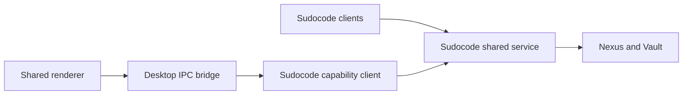

# Architecture

## Multi-Process Model

Sudowork is an Electron app with three types of processes:

- **Main Process** (`src/process/`, `src/index.ts`) — application logic, database, IPC handling. No DOM APIs available.
- **Renderer Process** (`src/renderer/`) — React UI. No Node.js APIs available.
- **Worker Processes** (`src/worker/`) — background AI tasks (gemini, codex, acp workers).

Cross-process communication must go through the IPC bridge.

## Sudocode Services

Sudocode owns the shared local Nexus service, its verified runtime assembly,
and the Vault, file and managed session capabilities. Desktop adapters in
`apps/desktop/src/common/scode/` use one `scode service stdio` connection.
Closing Sudowork disconnects that frontend; the shared service preserves
its data and remains available to other Sudocode clients.



The capability and lifecycle contract is maintained in
[Sudocode shared services](https://github.com/sudoprivacy/sudocode/blob/main/docs/shared-services.md).
Storage and IPC providers register before the application renderer loads;
runtime provisioning runs alongside the visible initialization screen.

## Renderer theme ownership

Desktop and WebUI mount the same `packages/renderer` components and stylesheet
entry. Theme selection applies `data-theme` on the document and `arco-theme` on
the body. Keep these responsibilities separate:

- `src/styles/variables.css` owns the application palette, semantic surfaces,
  foregrounds, borders and layout tokens for light and dark mode.
- `src/styles/arco-tokens.css` maps Arco's body-scoped neutral tokens to that
  palette. Both the normal body selector and Arco's dark selector are covered,
  including dialogs/popovers portaled outside the React root.
  `ConfigProvider` supplies locale and component defaults only; its `theme` prop
  must not write another palette into inline body variables. The CSS accent ramp
  retains the former provider's effective normal/hover/active brand colors.
- `uno.preset.ts` owns semantic utility names, shortcuts and preflights for both
  hosts. Their UnoCSS configs retain only host-specific content scanning and
  framework presets/transformers. The shared preset has no runtime dependency.
- Component CSS modules own geometry and states, consuming semantic tokens.
  An approval surface uses opaque `--bg-elevated` with `--foreground`; do not
  combine a fixed white surface with an inherited foreground. `--bg-base` may
  be translucent and is not a dialog surface. Legacy numbered background names
  alias the semantic surface tokens instead of defining a second palette.

The conversation approval panel uses the same action submission callback for
mouse and shortcuts. It keeps the composer mounted when an approval appears.
Native Arco buttons provide keyboard focus; Enter on a focused action activates
that action rather than the panel's default shortcut. Host approval payloads and
permission decisions remain at their existing bridge boundary.

The theme foundation does not automatically migrate every legacy inline color,
third-party syntax theme or embedded document style. New shared UI should consume
these semantic tokens rather than adding another palette or host-specific copy.

Visual regression acceptance uses the actual shared components, Arco CSS and
host-generated utilities, with only the confirmation IPC boundary replaced by a
fixture. From `apps/desktop`, start:

```bash
bunx vite --config tests/e2e/approval_theme/vite.config.ts --host 127.0.0.1 --port 26938
# Use APPROVAL_THEME_HOST=webui for the WebUI utility build.
```

Start a fresh ai-dev-browser session on that URL, then run
`tests/e2e/run_approval_theme.py --session-id <id> --output <evidence-directory>`
with its Python environment. The journey checks actual computed text contrast,
theme aliases, approval submission, composer draft retention and body-portaled
login dialogs, and saves light/dark screenshots. It does not execute a real tool
or test the engine's approval policy. Component/protocol regressions and shared
utility generation also run in the normal Vitest suite.

## Agent input delivery

For native scode sessions, `engine-core` owns pending inputs, safe-boundary steering,
next-turn admission, recall and cancellation. The CLI and ACP host share that
coordinator. Desktop's local ACP connection, remote Moss connection and WebUI
forward typed actions; none of these adapters schedules a second model queue.
Foreign agents retain their existing compatibility path.

The shared renderer sends Enter as `steer` and Tab as `queue`. Esc flushes pending
input, or cancels if none remains. Ctrl+C cancels while preserving normal copy
when text is selected. Esc waits for already-submitted attachment preparation;
cancellation bypasses it and invalidates preparations that have not reached the
agent. Queue chips come from revisioned engine snapshots. A user's transcript
bubble is added only on `committed`, not when admission is acknowledged.

`@sudowork/contracts/input-delivery` defines the boundary schema, while
`@sudowork/moss-client/input-delivery` only correlates transport requests and
projects revisions. Desktop and WebUI use the same `useInputDelivery` hook and
composer controls. Recall returns original text, attachments and selected skills;
host-expanded scaffolding is not re-applied to the editor.

WebUI keeps authentication and its single-writer lease at the server boundary.
An engine snapshot, rather than an earlier turn's result frame, determines whether
that lease can return to idle. Disconnection or an unknown admission outcome is
never automatically retried. Pending drafts live in the agent session's memory;
this protocol does not promise recovery after the engine process exits.

Native automatic turns can begin before host artifact bookkeeping finishes.
Hosts index generated files at their actual paths and do not move them away from
subsequent tools. Background and peer input use the engine's delivery policy;
the UI only displays their distinct source.

## Extension activity observations

The desktop extension activity snapshot queries `_sudocode/session/status` only
when the current owned ACP connection advertises `runtimeStatus.version = 1`.
It does not start an agent or model turn. Foreground state, typed question or
permission waits, and independent background counts come from that engine.
Historical messages remain preview data and cannot establish activity.

Rows retain the conversation and transport incarnation instead of collapsing
engines with the same Agent name or SID. A reply from a replaced connection or
task is discarded. Each observation carries its scope, timestamp and expiry;
unsupported, unattached, failed, invalid or expired observations remain unknown.
An idle foreground with confirmed background work is active; unconfirmed work
does not establish idle. A status read never authorizes tool takeover.

This snapshot covers desktop-owned connections and explicitly reports
`isComplete: false`. It is not a Nexus or cross-node presence directory, and an
absent row does not establish offline status. Remote Moss and foreign hosts
without the negotiated extension remain unknown. Independent CLI registration,
node authorization/routing and incarnation-safe external updates remain tracked
in [sudocode #1050](https://github.com/sudoprivacy/sudocode/issues/1050).

## IPC Communication

- Preload script: `src/preload.ts` — exposes a secure `contextBridge` API to the renderer
- Message type definitions: `src/renderer/messages/`
- All IPC channels are typed; add new channels in both the preload and the messages directory

## WebUI Server

Located in `src/webserver/`.

- Express + WebSocket for real-time communication
- JWT authentication for remote access
- Enables network clients to access the agent UI remotely (not just local Electron window)

## Cron System

Located in `src/process/services/cron/`.

- Based on `croner` library
- `CronService`: task scheduling engine
- `CronBusyGuard`: prevents concurrent execution of the same job
