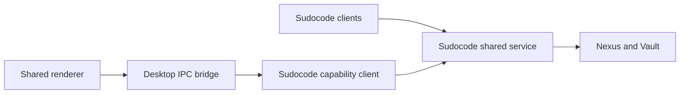

# Architecture

## Multi-Process Model

Sudowork is an Electron app with three types of processes:

- **Main Process** (`src/process/`, `src/index.ts`) — application logic, database, IPC handling. No DOM APIs available.
- **Renderer Process** (`src/renderer/`) — React UI. No Node.js APIs available.
- **Worker Processes** (`src/worker/`) — background AI tasks (gemini, codex, acp workers).

Cross-process communication must go through the IPC bridge.

## Sudocode Services

Sudocode owns the shared local Nexus service, its verified runtime assembly,
and the Vault, file and managed session capabilities. Desktop adapters in
`apps/desktop/src/common/scode/` use one `scode service stdio` connection.
Closing Sudowork disconnects that frontend; the shared service preserves
its data and remains available to other Sudocode clients.

The capability and lifecycle contract is maintained in
[Sudocode shared services](https://github.com/sudoprivacy/sudocode/blob/main/docs/shared-services.md).
Storage and IPC providers register before the application renderer loads;
runtime provisioning runs alongside the visible initialization screen.

## Agent input delivery

For native scode sessions, `engine-core` owns pending inputs, safe-boundary steering,
next-turn admission, recall and cancellation. The CLI and ACP host share that
coordinator. Desktop's local ACP connection, remote Moss connection and WebUI
forward typed actions; none of these adapters schedules a second model queue.
Foreign agents retain their existing compatibility path.

The shared renderer sends Enter as `steer` and Tab as `queue`. Esc flushes pending
input, or cancels if none remains. Ctrl+C cancels while preserving normal copy
when text is selected. Esc waits for already-submitted attachment preparation;
cancellation bypasses it and invalidates preparations that have not reached the
agent. Queue chips come from revisioned engine snapshots. A user's transcript
bubble is added only on `committed`, not when admission is acknowledged.

`@sudowork/contracts/input-delivery` defines the boundary schema, while
`@sudowork/moss-client/input-delivery` only correlates transport requests and
projects revisions. Desktop and WebUI use the same `useInputDelivery` hook and
composer controls. Recall returns original text, attachments and selected skills;
host-expanded scaffolding is not re-applied to the editor.

WebUI keeps authentication and its single-writer lease at the server boundary.
An engine snapshot, rather than an earlier turn's result frame, determines whether
that lease can return to idle. Disconnection or an unknown admission outcome is
never automatically retried. Pending drafts live in the agent session's memory;
this protocol does not promise recovery after the engine process exits.

Native automatic turns can begin before host artifact bookkeeping finishes.
Hosts index generated files at their actual paths and do not move them away from
subsequent tools. Background and peer input use the engine's delivery policy;
the UI only displays their distinct source.

## IPC Communication

- Preload script: `src/preload.ts` — exposes a secure `contextBridge` API to the renderer
- Message type definitions: `src/renderer/messages/`
- All IPC channels are typed; add new channels in both the preload and the messages directory

## WebUI Server

Located in `src/webserver/`.

- Express + WebSocket for real-time communication
- JWT authentication for remote access
- Enables network clients to access the agent UI remotely (not just local Electron window)

## Cron System

Located in `src/process/services/cron/`.

- Based on `croner` library
- `CronService`: task scheduling engine
- `CronBusyGuard`: prevents concurrent execution of the same job
