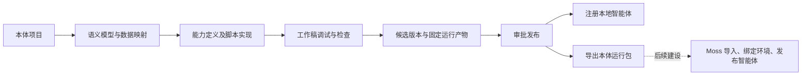
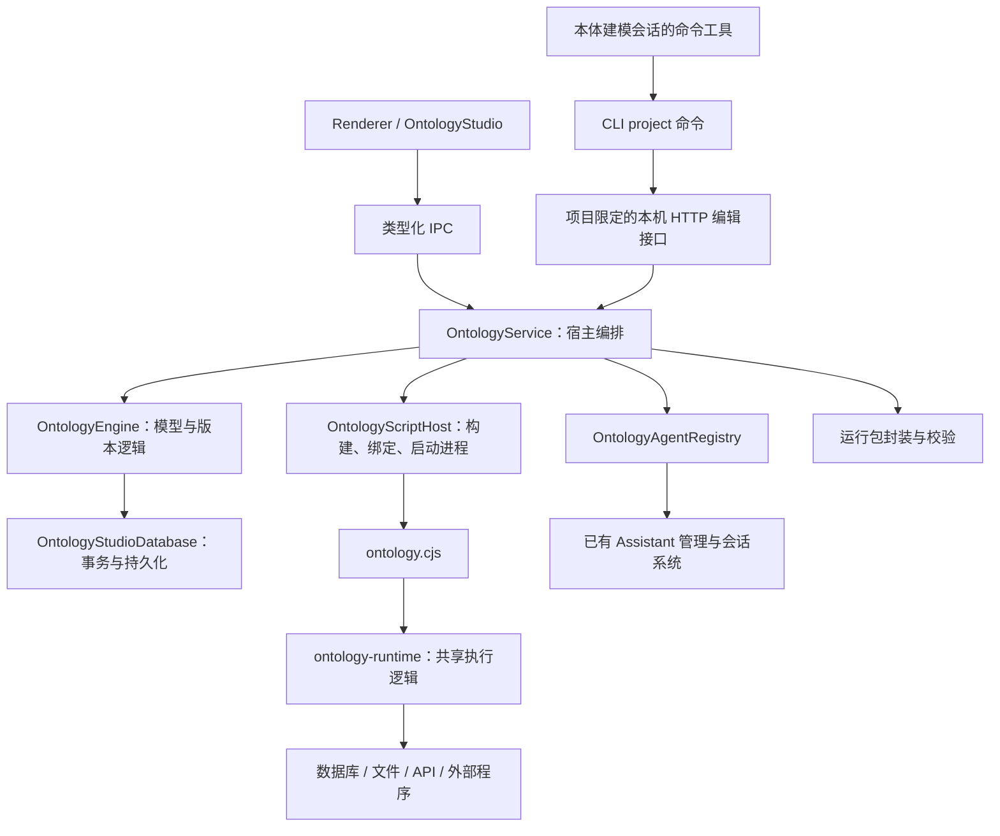

# 本体工作台：当前设计与实现

梳理日期：2026-10-27。依据当前本地源码，包含尚未提交的脚本运行与导出改造。本文件说明已经存在的行为及其边界；之前的[实施方案](../plans/2026-10-26-ontology-script-package-design.md)中的设想，只有在代码中落实后才列为已实现。

## 1. 当前产品结构

本体工作台统一管理可编辑本体项目。用户建立语义模型、绑定数据、编写与调试能力，发布固定版本，再注册本地智能体或导出 `.sudoonto`。完整包可在另一客户端导入、重新绑定、修改后再次发布导出，具体契约见 [Sudowork 本体包](./sudoonto-package.md)。

当前主链路为：



本体到智能体之间没有 Skill 发布环节。本体专用 MCP 注册与打包入口已移除。普通技能、普通 MCP、浏览器 MCP、团队 MCP 继续使用原来的实现。

客户端页面中的“本体库”目前是本机项目列表，不是未来 Moss 上的租户本体商店。工作台中的“发布”也是本地版本发布，不会自动上传 Moss。

## 2. 统一项目与两类交换格式

新建本体、标准文件导入、完整包导入、连接数据库都进入同一种可编辑工作台。用户不需要选择 RDF/Sudograph 项目。数据库入口直接使用现有本体引擎扫描来源并创建工作稿，支持 SQLite、MySQL、PostgreSQL，不再受 Sudograph 环境变量控制。

| 输入/输出 | 用途 |
| --- | --- |
| RDF/XML、OWL/XML | 保留标准语义交换，导入后继续建模并绑定实际数据 |
| .sudoonto | 恢复模型、映射、能力源码、智能体说明和资源契约；修改后重新导出 |
| 数据库连接 | 从真实表结构生成工作稿，再通过 AI 或图形界面调整 |

同一本体可以组合使用以上输入。内部仍以语义文档和执行投影表达模型，Moss 后续直接消费本体包，不要求在服务端重新建模。代码中留存的 Sudograph 内部接口不参与当前新项目的创建流程，也不构成客户端功能的启动依赖。

依据：[数据库建模服务](../../apps/desktop/src/process/services/ontology/OntologyService.ts)、[工作台入口](../../packages/ontology-ui/src/studio/OntologyStudio.tsx)、[包导入恢复](../../packages/ontology-runtime/src/authoring.ts)。

## 3. 工作台的用户流程

| 页面 | 当前实现 |
| --- | --- |
| 本体库 | 按创建时间倒序列出本机项目，创建项目，导入本体，打开项目；RDF 项目可重命名、删除，编辑不改变创建时间；旧数据不回填历史创建时间 |
| 建模 | 编辑对象、属性、关系和图形布局；保存工作稿；并列使用本体对话 |
| 数据 | 导入数据文件，连接和扫描数据源，预览资产、同步字段结构、维护属性到字段的映射 |
| 能力 | 新建、编辑、删除和运行逻辑函数及动作，保留源码、参数、执行配置和输出契约 |
| 检查 | 展示结构、关系数据和质量规则检查结果；定位问题；请求 AI 修复后重新检查 |
| 发布 | 创建候选版本、查看差异、审批或拒绝；创建并注册智能体；标准文件导出与运行包导出 |

数据页新增运行环境配置，允许按原资源 ID 重新绑定数据库、文件以及接口和秘密槽位。发布页新增随包智能体定义编辑。完整包导入恢复可编辑项目，默认保留原身份，也可以创建独立派生本体。仓库保留的旧 `OntologyWorkbench` 组件不作为当前主路由。

当前主路由是 `/app/ontology/:ontologyId/:view?`，由 Renderer 的页面适配器把 IPC 包装为 `IOntologyStudioApi`，再交给共享 UI。组件本身不直接访问文件系统、数据库或 Node 子进程。

依据：[Renderer 页面](../../packages/renderer/src/pages/ontology/index.tsx)、[Studio 入口](../../packages/ontology-ui/src/studio/OntologyStudio.tsx)、[数据与能力页](../../packages/ontology-ui/src/studio/StudioPages.tsx)、[发布页](../../packages/ontology-ui/src/studio/StudioReleasePage.tsx)。

## 4. 模块职责和调用关系



| 模块 | 责任 |
| --- | --- |
| `packages/ontology-common` | 对象、关系、资产、函数、动作、版本、语义文档、运行包和调用结果类型；语义投影等共享逻辑 |
| `packages/ontology-engine` | 工作稿修改、资产生成模型、默认能力生成、结构检查、版本快照、版本差异、蓝图定义、标准语义文件解析与导出 |
| `packages/ontology-runtime` | 运行产物构建、包校验、资源绑定、统一 CLI、能力执行、ZIP 导出和解包 |
| Desktop `OntologyService` | 协调模型、数据访问、调试、发布、导出、系统保存对话框与智能体注册 |
| Desktop `OntologyScriptHost` | 定位 Node/CLI、创建运行产物、写私有绑定文件、管理子进程超时和取消、加载固定发布版本 |
| Desktop `OntologyAgentRegistry` | 智能体注册状态、重试、并发串行化、卸载与状态恢复 |
| Desktop `OntologyWriteBridge` | AI 建模的项目限定编辑通道，以及桌面通知资源通道 |
| `packages/ontology-ui` | 可复用的 Studio 页面与导出弹窗 |
| `packages/renderer` / `packages/host-bridge` | 桌面路由、会话嵌入、i18n、类型化跨进程契约 |

数据预览、质量检查等宿主操作直接复用共享执行库。函数、关系和动作的显式运行入口则由 `OntologyScriptHost` 启动 CLI。这两类调用应分别描述，不能把所有工作台操作都称为 CLI 调用。

## 5. 模型、数据和存储

### 5.1 本体包含哪些内容

RDF 工作稿的主要结构是 `IOntologyWorkbenchSnapshot`：

| 内容 | 用途 |
| --- | --- |
| `semanticDocument` | RDF 语句、IRI、前缀、导入声明，以及支持范围内保留的 OWL 公理信息 |
| `objects` / `relations` | 图形编辑器可展示和编辑的对象、属性、关系投影 |
| `assets` / `connectors` | 数据资产、字段结构、来源及本机连接配置 |
| `mappings` | 对象属性到资产字段的映射 |
| `qualityRules` | 面向映射数据的规则表达式 |
| `logicFunctions` / `actions` | 能力参数、实现、配置和启用状态 |
| `publishedVersions` | 已创建版本的固定快照和运行摘要 |
| `agentBlueprints` | 本地智能体定义、版本归属和注册状态 |
| `revision` / `agentRevision` | 模型和智能体相关变更的冲突检测依据 |

语义文档保留图形编辑器没有直接暴露的语句。保存对象与关系时，数据库层先协调语义文档，再从语义文档生成编辑投影，避免两份模型持续分叉。标准文件支持 RDF/XML 与 OWL/XML；这不等于实现完整 OWL 推理，也不会自动下载 `owl:imports` 引用的环境。

只有 RDF/OWL 文件不能还原全部运行能力。SQL、函数体、动作配置、数据映射和环境契约还依赖运行投影与能力目录，因此另有完整运行包格式。

### 5.2 保存、冲突和幂等

图形编辑器在 Renderer 保存尚未提交的 draft，并用本机 `localStorage` 缓存未保存编辑。收到服务端更新时，不直接覆盖正在编辑或未保存的内容。

保存请求携带 `expectedRevision` 和 `operationId`。服务先验证输入与引用，数据库再在事务中检查旧快照、修订和操作记录。同一操作 ID 与相同请求可幂等重试；相同 ID 携带不同内容会报冲突。模型有实质变化时推进模型修订，调用计数等变化不会被当作新的模型修订。

模型或能力保存后，服务构建工作稿运行产物；执行工作稿能力前也会调用同一构建器。当前“写数据库”和“构建产物”是先后两个步骤，不是一个跨数据库与文件系统的原子事务。构建失败时，可能出现工作稿已保存、运行产物未成功更新的状态；再次运行会重新尝试构建。

### 5.3 本机存储布局

默认位于 `getDataPath()/ontology-studio/`：

```text
ontology-studio/
  studio.db                         项目、工作稿、操作记录、会话索引
  runtime/
    producer-id                     本机产物身份的稳定种子
    artifacts/<runtimeDigest>/      按内容摘要命名的运行产物目录
    bindings/*.json                 本地运行绑定，权限 0600
  project-contexts/*.json            AI 编辑上下文，权限 0600
```

`studio.db` 使用 WAL；主要表为 `studio_projects`、`studio_workspaces`、`studio_operations`、`studio_sessions`、`studio_settings`。快照在系统支持时由 Electron `safeStorage` 加密。系统加密不可用且检测到连接凭据时，保存会被拒绝。返回 Renderer 的结果另经过凭据脱敏。

工作台自身仍使用原有 `better-sqlite3` 存储。迁移到 `node:sqlite` 的是本体运行时访问业务 SQLite 的那部分，不是整个 Sudowork 数据库层。

依据：[数据类型](../../packages/ontology-common/src/index.ts)、[语义文档及投影](../../packages/ontology-common/src/studio.ts)、[保存事务](../../apps/desktop/src/process/services/ontology/OntologyStudioDatabase.ts)、[模型保存服务](../../apps/desktop/src/process/services/ontology/OntologyService.ts)。

## 6. AI 如何建模

本体建模会话带有 `purpose: ontology` 和 `ontologyId`，仍复用已有的会话、命令工具、消息展示及会话恢复机制。

准备会话时，宿主确定项目 authority，生成项目限定的编辑上下文，并把 CLI 路径和使用说明注入会话。AI 先调用 `project list --context ...` 发现命令，再使用 JSON 请求读写模型。

RDF 命令覆盖工作稿读取、对象/属性/关系/映射/规则/函数/动作编辑、资产预览、生成工作稿、检查及受限的查询验证。当前新项目使用同一命令目录；保留的 Sudograph 内部接口不参与新工作台的建模入口。

编辑命令通过本机 `127.0.0.1` HTTP 通道进入宿主，使用项目范围的 token。建模上下文不能直接审批发布、注册运行智能体或执行业务动作；函数验证仅允许 SQL/内置查询。生成自定义脚本动作时，引用的脚本文件必须先作为项目资产导入。

**去掉本体 MCP 后，本机仍有一个按需启动的编辑/通知 HTTP 通道。** 它属于桌面宿主，用来复用工作稿事务与桌面通知，不是每个本体启动一个 MCP Server。运行包的业务查询与动作通过 CLI 自己执行，部署到 Moss 不需要带上这个编辑通道。

同一个 CLI 二进制也包含 `project` 子命令，但导出包不会携带本机的编辑上下文和 token；正常独立使用只需要运行命令。

依据：[会话准备](../../apps/desktop/src/process/services/ontology/ontologyConversationRuntime.ts)、[项目脚本上下文](../../apps/desktop/src/process/services/ontology/ontologyProjectRuntime.ts)、[命令目录](../../apps/desktop/src/process/services/ontology/ontologyProjectCommands.ts)、[编辑权限检查](../../apps/desktop/src/process/services/ontology/OntologyWriteBridge.ts)。

## 7. “同一套脚本”具体指什么

### 7.1 统一的运行产物

`buildOntologyArtifact` 从工作稿或指定版本构建运行目录。它收集语义文档、执行投影、激活的能力、数据依赖和 CLI，生成摘要并保存。相同运行内容复用同一目录。

| 能力 | 当前实现形式 |
| --- | --- |
| SQL 函数 | 函数体存入 `.sql`；CLI 解析参数并使用绑定的数据库执行 |
| `typescript` 函数 | 函数体存入 `.js`，使用现有受限 VM 执行语义；没有独立的 TypeScript 转译流程 |
| Python 函数 | 函数体存入 `.py`，由统一包装器提供 `input` / `params`，读取 `result` |
| 内置对象查询 | 能力目录与运行模型描述映射；查询算法包含在统一 CLI 内 |
| 关系遍历 | 运行模型描述直接关联、中间表和关系语义；统一 CLI 执行算法 |
| SQL 动作 | SQL 实现文件和动作参数契约 |
| function 动作 | 引用能力目录中的逻辑函数；资源依赖合并到动作 |
| API / notification 动作 | 请求配置与目标环境资源绑定 |
| custom_script 动作 | 对识别出的 Node/Python/sh/bash 脚本固定源码与参数描述；未识别的外部程序声明为运行绑定 |

因此，“脚本方案”已经实现为**固定运行模型 + 能力实现文件 + 统一脚本执行器**。内置查询和关系遍历没有为每个对象另生成一份独立 Python/JS 程序；它们复用随包分发的 CLI 实现。代码中也没有新增一个注册到智能体平台的原生本体工具适配器。

### 7.2 三个入口如何保持一致

| 调用入口 | 使用的产物 | 环境绑定 |
| --- | --- | --- |
| 工作台调试 | 当前工作稿通过统一构建器生成的产物 | 当前本机连接器、文件与解释器 |
| 已注册本地智能体 | 版本记录中 `runtimeDigest` 指向的固定产物 | 宿主生成的私有绑定文件 |
| 导出后独立运行 | 从固定版本产物封装得到的包 | 嵌入数据或目标环境填写的绑定 |

工作稿与候选版本含有不同版本元信息，因此不要求二者整个目录的摘要相同；它们使用同一个构建器和执行实现。已发布版本到导出包之间，运行内容摘要保持一致，导出只增加数据附件和验证报告。

CLI 按调用启动进程，没有为每份本体维持常驻执行服务或连接池。Node CLI 包含 JavaScript 数据库驱动，Oracle 走 thin 模式；Python 和 shell 仍要求宿主提供相应解释器。

### 7.3 调用协议

| 命令 | 当前语义 |
| --- | --- |
| `inspect` | 模型、manifest、缺失绑定 |
| `list` | 能力目录和运行摘要 |
| `describe <id>` | 单项能力的参数、实现、资源依赖 |
| `invoke <id>` | 校验参数、依赖和授权，然后执行 |
| `validate` / `verify` | 当前二者执行相同的包、绑定与资源检查 |

能力 ID 为 `logic.<code>`、`relation.<code>`、`action.<code>`。请求来自 stdin 或 `--input-file`，参数不作为任意 SQL/程序路径的替代入口。

```json
{
  "protocolVersion": 1,
  "requestId": "review-example",
  "arguments": { "query": {} }
}
```

```bash
node scripts/ontology.cjs invoke logic.orders_lookup \
  --package /path/to/package \
  --bindings /path/to/bindings.json \
  --input-file /path/to/request.json
```

响应以 `protocolVersion`、`requestId`、`isSuccess` 为外层结构，成功返回 `data`，失败返回 `error`。当前成功结果的通用 `meta` 主要记录执行过的函数 ID；并未把方案示例中的完整审计信息全部实现。

`invoke` 只要求被调用能力及其函数依赖涉及的 `resourceRefs` 已绑定。未配置一个通知接口，不会阻止不依赖它的订单查询。`validate` / `verify` 则检查整个包的绑定。

依据：[运行产物构建](../../packages/ontology-runtime/src/artifact.ts)、[CLI 协议](../../packages/ontology-runtime/src/cli.ts)、[共享执行器](../../packages/ontology-runtime/src/execution.ts)、[宿主执行入口](../../apps/desktop/src/process/services/ontology/OntologyScriptHost.ts)。

## 8. 检查、发布和智能体

### 8.1 三层检查

工作台的发布前检查组合结构一致性、关系数据绑定检查和质量规则执行结果。质量规则通过映射读取样本数据，结果可为通过、失败、跳过或错误；缺失映射等情况不能解释为规则通过。错误级阻塞项会阻止候选创建，警告可随版本保留。

运行包的验证是另一项操作：它检查包完整性、环境绑定及资源可验证的部分，不重放所有函数，也不执行任意业务动作。

| 资源验证标记 | 实际含义 |
| --- | --- |
| `schema` | 对关系数据库读取字段结构并对比声明 |
| `file-access` | 检查绑定文件可访问，不代表全部文件内容与字段已验收 |
| `binding-only` | 只完成绑定层检查，不表示远程资源已经连通或业务逻辑正确 |

### 8.2 发布冻结

1. 获取当前模型修订并执行检查。
2. 创建 `submitted` 候选，保存模型、能力、映射和资源环境快照。
3. 用候选快照构建运行产物，把 `runtimeDigest` 写回版本记录。
4. 审批时加载并校验这份已有产物，再将版本置为 `published`。
5. 智能体运行和导出按版本摘要加载，不用新工作稿替代旧版本代码。

资产结构随候选固定；数据库地址、账号等实际环境绑定仍可来自当前宿主。这意味着发布固定的是模型与能力，不是远程数据库未来的每一条业务记录。需要固定数据时，应选择快照导出。

候选保存、产物构建和摘要回写不是一个原子事务。失败的中间状态需要报告或重试；缺失有效 `runtimeDigest` 的版本不会被当作可运行发布产物加载。

### 8.3 本体直接生成智能体

蓝图引用 `ontologyVersionId`。注册器按工作区串行化变更，同一版本的并发注册复用进行中的操作，并维护 `draft → registering → registered / failed` 状态。

注册结果是已有 Assistant 体系中的本地 `custom` 智能体，记录 `{workspaceId, versionId, blueprintId}` 归属。先创建为禁用状态，检查发布产物存在，再启用；失败时保留错误并支持重试。

会话启动或恢复时读取该智能体的本地规则文件，并注入固定 CLI 命令、包目录与绑定路径。智能体通过现有命令工具调用本体能力。智能体目录不复制一套独立的本体业务实现，也不会先创建 Skill。

工作台通过服务执行能力后会更新调用计数；智能体直接调用独立 CLI 的结果目前不自动回写工作台计数。统一跨宿主调用审计仍未形成完整产品链路。

依据：[检查与发布服务](../../apps/desktop/src/process/services/ontology/OntologyService.ts)、[版本冻结](../../packages/ontology-engine/src/index.ts)、[版本环境快照](../../packages/ontology-engine/src/index.ts)、[注册器](../../apps/desktop/src/process/services/ontology/OntologyAgentRegistry.ts)、[智能体运行上下文](../../apps/desktop/src/process/services/ontology/OntologyService.ts)。

## 9. 运行包的交付契约

### 9.1 标准语义导出与运行包导出

| 导出形式 | 面向用途 | 包含运行环境信息 |
| --- | --- | --- |
| RDF/XML、OWL/XML | 标准语义交换、模型查看与继续编辑 | 不完整，不作为可运行部署包 |
| `.sudoonto` | 转移固定本体能力，供独立运行和未来 Moss 消费 | 包含资源契约、绑定示例和运行要求；真实目标环境仍需配置 |

运行包入口位于已发布版本操作中，不要求先注册本地智能体。

```text
manifest.json
authoring/project.json
ontology/model.rdf
ontology/runtime-model.json
capabilities/catalog.json
capabilities/implementations/*
scripts/ontology.cjs
agent/definition.json
agent/AGENT.md
environment/resources.json
environment/bindings.example.json
environment/bindings.schema.json
environment/runtime.lock.json
verification/export-report.json
checksums.json
assets/*                         选择携带数据时才有
```

`agent/definition.json` 提供默认 profile、名称、说明、指令引用、能力引用及宿主授权声明。用户在发布页编辑随包智能体定义，发布后固定并随包恢复。包内没有本地注册 ID、会话历史、MCP 端口或目标租户实例；直接修改已安装智能体的私有规则文件不会自动回写包定义。

### 9.2 模型、实现和环境分离

| 包中保存 | 包外提供 |
| --- | --- |
| 对象、属性、关系、IRI、映射、规则 | 数据库实际地址、账号、密码 |
| SQL/JS/Python 实现及受支持脚本源码 | API 地址、认证头、通知渠道 |
| 能力目录、参数、资源引用 | 未嵌入的文件路径、外部程序路径与参数 |
| 连接器类型与资产结构 | Python 解释器位置与宿主执行权限 |
| 默认智能体说明 | Moss 租户、实例、会话、模型服务与授权 |

绑定文件的实际字段为 `connections`、`files`、`actions`、`secrets`、`python`、`allowedActions`。嵌套的连接凭据与参数可沿用当前连接器格式。

结构化配置中的敏感字段转换成秘密槽位，连接凭据与临时通知地址不随包输出。源码正文中的硬编码秘密不具备同等自动清除保证；用户主动选择携带的原始文件也不会自动进行内容脱敏。

### 9.3 数据快照与完整性

导出预检列出资源，用户明确勾选本地文件或 SQLite 后才携带数据。SQLite 使用一致性备份，覆盖整个数据库，不仅是模型引用的几个表。

嵌入数据默认只读。需要业务写入时，目标宿主在包外提供可写数据库副本，并显式设置连接可写及动作许可。

身份有三个层次：

| 标识 | 含义 |
| --- | --- |
| `ontologyId` | 本体稳定身份，由宿主持久化 producer ID 与项目身份构成 |
| `runtimeDigest` | 固定运行内容摘要，覆盖语义、执行投影、能力、CLI、默认智能体及环境声明 |
| `packageDigest` | 分发包文件索引摘要，另覆盖选择的数据附件与导出报告 |

调用次数和最近运行时间不进入能力实现摘要。数据快照或导出报告时间变化可改变 `packageDigest`，但不会改变这次封装引用的 `runtimeDigest`。

导出使用私有 staging 目录收集与检查文件，再流式压缩到临时目标并原子替换正式输出。失败或取消清理临时产物。解包器拒绝越界路径、链接、重复/大小写冲突等异常，并核对文件索引和运行摘要。

摘要用于核对内容完整性，不是发布者签名；Moss 的发布者信任和上架审批尚未实现。

### 9.4 导出结果如何解释

若任何必要绑定缺失，包仍可以按“需要绑定”状态导出，报告列出缺项；此时不执行整套环境验证。绑定齐备时，桌面服务使用宿主的校验 CLI 对 staging 目录执行 `verify`，把解释器和资源的验证范围写入报告；不会仅为重新封装而启动外来包中的 CLI。

生产导出检查发生在独立 staging 目录。压缩后再解包并运行的流程由独立验收测试覆盖，当前生产导出流程没有再做一次 ZIP 解包回放。

界面显示文件路径、大小、分发摘要、运行验证状态和剩余绑定数量，并支持收集、验证、压缩阶段的进度与取消。

依据：[运行包类型](../../packages/ontology-common/src/runtimePackage.ts)、[产物构建与绑定](../../packages/ontology-runtime/src/artifact.ts)、[导出/解包](../../packages/ontology-runtime/src/archive.ts)、[导出弹窗](../../packages/ontology-ui/src/studio/StudioPackageExport.tsx)。

## 10. 执行权限与运行条件

当前 CLI 要求兼容 Node.js 22.22.2 及以上环境，并检查 `node:sqlite` 备份 API。Python 函数沿用受限内建函数的执行包装；任意第三方 Python 环境和脚本依赖不会自动安装。

动作执行需要 `allowedActions` 列出动作 ID；数据库写还要求目标连接显式 `writable: true`，包作者的可写设置不会自动成为目标环境的写授权。

本地工作台的动作调用由宿主授权本次动作。本地已注册智能体的绑定文件目前包含该发布版本的全部动作许可，具体业务确认还依赖已有会话执行权限及规则；它不是为每次动作另实现的一套人工审批服务。

当前有输入、输出、超时和文件数量/体积限制：CLI 请求约 1 MiB，桌面调用 stdout 约 16 MiB、默认超时 30 秒，包约 512 MiB、4096 个文件。超时取消由桌面宿主管理子进程树；动作外层超时会提示结果可能不确定，不能自动重试。

这些检查不构成多租户沙箱。未来 Moss 仍需提供执行隔离、按权限配置的数据账号、凭据注入及资源限制。按调用启动脚本已移除每本体 MCP 服务的要求，但没有移除解释器启动和数据库建连成本。

## 11. 当前边界与 review 重点

下列内容是源码现状，不应仅凭之前的方案当作已经完成：

| Review 项 | 当前状态及影响 |
| --- | --- |
| 建模入口 | 标准文件、完整包和数据库统一进入当前工作台；旧的独立模型不做迁移 |
| 动作的产品入口 | 已增加动作编辑和执行；复杂脚本的递归依赖仍需作者确保可移植 |
| 脚本粒度 | 内置查询、关系算法打在统一 CLI 中；不是所有能力均生成独立脚本文件 |
| 智能体导出 | 随包默认定义及自定义指令可编辑、导出和恢复；当前不提供多个 profile |
| 环境交付 | 可交付定义、实现、资源声明和选定数据；没有自动安装环境、自动部署服务的编排 |
| 外部代码依赖 | 固定可识别的直接脚本资源；没有完整解析任意脚本的递归 import、动态文件和网络依赖 |
| 依赖锁 | `runtime.lock.json` 有 Node/Python/shell 要求和 CLI 摘要；不是完整第三方依赖版本清单与跨平台认证结果 |
| 验证级别 | 发布前检查、包完整性、绑定检查、业务能力验收是不同层级；不能统一标注成“部署成功” |
| 协议严格性 | 包模型、参数、权限与引用有结构校验，绑定输入采用 Zod；部分底层错误仍统一返回 `EXECUTION_FAILED` |
| 保存与构建一致性 | 数据库修改和产物文件构建非原子步骤；失败恢复仍依赖报告和重试 |
| 运行统计 | GUI 经服务调用会回写统计；智能体直接 CLI 调用尚无统一回流审计 |
| 老产物 | 不迁移旧本体 MCP 发布产物；缺少脚本摘要的版本需要重新创建候选并发布 |
| Moss | 本体目录、上传、审批、环境部署、租户可见性和普通用户访问均属于后续建设 |

从当前实现接到未来 Moss，已有可复用的是“包加载与校验 → 环境绑定 → CLI 检查/调用 → 默认智能体说明”。Moss 要补的是目录与部署管理、凭据及执行权限、智能体会话接入，不能仅上传两个文件就假定服务器环境已成立。

## 12. 测试证据与阅读入口

客户端完整包闭环的主要回归见新增 `ontologyPackageCirculation.integration.test.ts` 和 `ontologySudoonto.dom.test.tsx`，包括静态导入、恢复编辑、版本来源、绑定新数据库、原样再导出及交互。其余直接回归证据如下：

| 测试 | 覆盖的设计约束 |
| --- | --- |
| [ontologyScriptPackage](../../apps/desktop/tests/integration/ontologyScriptPackage.integration.test.ts) | 原源文件移走后的运行、数据库快照、篡改检查、秘密分离、绑定依赖、目标宿主写权限、脚本固定和取消 |
| [ontologyService](../../apps/desktop/tests/unit/ontologyService.test.ts) | 建模生成产物、真实 CLI 执行、关系/动作语义、冻结发布与桌面导出服务 |
| [ontologyAgentToolRoundtrip](../../apps/desktop/tests/unit/ontologyAgentToolRoundtrip.test.ts) | 在具备 Sudocode 二进制时，以模拟模型服务驱动真实命令工具调用 CLI，并恢复会话 |
| [ontologyProjectCli](../../apps/desktop/tests/unit/ontologyProjectCli.test.ts) | 项目命令发现与 Sudograph 冲突恢复信息 |
| [ontologyConversationRuntime](../../apps/desktop/tests/unit/ontologyConversationRuntime.test.ts) | 普通会话和无关 MCP 配置保留、本体会话注入脚本上下文 |
| [ontologyPackageExport](../../apps/desktop/tests/unit/ontologyPackageExport.dom.test.tsx) | 数据明确勾选、导出请求合并、取消和导出结果展示 |

实际操作命令与绑定示例见[本体脚本运行与导出](./ontology-script-runtime.md)。建议 review 顺序是：先看第 2 节的产品分流，再看第 7 节的统一执行语义、第 9 节的交付契约，最后看第 11 节的当前边界。
